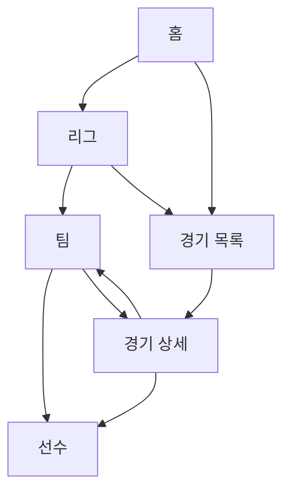

# FM 스타일 실축 데이터 탐색 서비스 통합 PRD

Nov 16, 2026 · @Son Young-su

## 1. 문서 개요

실제 리그·팀·선수·경기 데이터를 풋볼매니저(FM)의 고밀도 대시보드 감성으로 탐색하는 한국어 웹서비스를 만든다. 이 문서는 세 개의 PRD(FM 스타일 실축 포털 PRD, AllLeaguesFans PRD v1.0, 풋볼매니저 스타일 축구 정보 홈페이지 PRD)를 하나로 통합한 기준 문서다.

| 항목 | 내용 |
| --- | --- |
| 제품명 | AllLeaguesFans (가칭, 디자인 착수 전 확정) |
| 버전 | 통합 v1.0 |
| 대상 독자 | 제품 담당자, 디자이너, 프런트엔드·백엔드 개발자 |
| 기본 환경 | 한국어, 데스크톱 중심 반응형 웹(iPhone·iPad Safari 포함), 시간대 Asia/Seoul |
| 문서 성격 | 범위·설계 제안. allleaguesfans.com은 현재 TheSportsDB → Supabase → Vercel 구조로 개발 중 |

**제품 비전:** “실제 축구를, FM처럼 깊게 본다.” 리그 순위에서 팀 스쿼드, 선수 기록, 경기 상세로 자연스럽게 이동하는 분석실 같은 경험을 제공한다.

**목표**

1. 리그 → 팀 → 선수 또는 경기로 3번 이내의 화면 이동(3클릭)으로 연결한다.
2. 리그·시즌·기록 범위와 데이터 기준 시각을 모든 화면에 명시한다.
3. 촘촘한 표, 정렬·필터, 빠른 통합 검색으로 탐색 자체를 즐겁게 만든다.
4. 누락·지연·정정 상태를 드러내고 확인된 실제 데이터만 보여준다.
5. PC, iPhone, iPad Safari에서 같은 핵심 흐름을 완료할 수 있게 한다.

**비목표 (이번 버전에서 하지 않음)**

- 경기 시뮬레이션, 구단 경영, 이적 협상, 세이브 파일, 3D 경기 재현
- 베팅·배당·승부 예측, 판타지 게임
- 회원가입·커뮤니티·소셜 기능 (즐겨찾기는 브라우저 저장)
- 뉴스 자동 수집, 유료 결제
- FM의 명칭·로고·스킨·스크린샷·독점 능력치(CA·PA) 사용

## 2. 통합 원칙과 충돌 조정

세 문서는 비전과 UI 방향은 같고, 데이터 공급자·아키텍처·리그 범위·파생 능력치에서 갈린다. 통합 기준은 세 가지다: ① K리그를 포함할 수 있는 선택을 우선한다, ② 데이터 신뢰성 규칙(AllLeaguesFans PRD)을 기능 요구보다 앞에 둔다, ③ 개발 표준(TDD·Docker·CI)은 가장 구체적인 문서(FM 포털 PRD)를 따른다.

| 주제 | 원본별 입장 | 통합 결정 |
| --- | --- | --- |
| 데이터 공급자 | football-data.org v4 / API-FOOTBALL / API-FOOTBALL 우선 | 전 대회를 받는 통합 공급자(Sportmonks 또는 TheStatsAPI) + K리그 공식 Open API 보정 + TheSportsDB 이미지 보조. football-data.org는 UEL·UECL·컵 미지원으로 제외. API-FOOTBALL은 K리그 데이터 부정확으로 제외. 공급자 중립 스키마로 교체 가능하게 설계 |
| 아키텍처 | Express BFF 프록시 / Supabase 수집·저장 / GitHub Actions 정적 JSON | 현재 구조 유지: 수집 함수 → Supabase Postgres → 읽기 전용 뷰·Vercel 함수 → React(Vercel). 브라우저는 외부 API를 직접 호출하지 않음. 별도 Express 서버는 두지 않음 |
| MVP 리그 | 무료 12개 대회 / K리그1·2 / 유럽 5대 + K리그1 | K리그1·K리그2 최우선 + 유럽 5대 리그 + UCL. UEL·UECL·국내 컵·슈퍼컵은 P1, 최종 목표는 모든 대회. 데이터 검증 게이트를 통과한 대회만 공개 |
| 갱신 주기 | 1\~2분 캐시 / 진행 경기 5분 / 일 3회, 실시간은 v2.0 | 진행 경기 목표 5분. 공급자 호출 한도·약관이 허용하지 않으면 일 3회 + 종료 후 수집으로 낮춤 |
| FM식 1\~20 능력치 | 없음 / 금지 / P0 파생 지표 | P1 실험 기능. “실측 백분위 지표”로 명명하고 FM 능력치인 척하지 않음. 결정 기록 D-05 참조 |
| 전술판·피치 | 템플릿 인터랙티브 보드 / 좌표 없으면 추정 금지 / 최다 사용 라인업 | 경기 피치는 제공 좌표가 있을 때만. 팀 전술판은 “사용자 편집 보드” 라벨을 달아 P1 |
| 라우팅 | 명시 없음 / 경로형 URL / 해시 라우터 | 경로형 URL(Vercel 리라이트로 지원, 공유·SEO에 유리) |
| 검색 디바운스 | 250ms / 300ms / 300ms | 300ms, 한글 IME 조합 완료 후 검색 |
| 테스트 커버리지 | 전체 80% / 명시 없음 / 도메인 90% | 전체 80% 이상, 도메인 로직 90% 이상 |
| 일정 | 4단계 / 25\~37 작업일 / 10주 | 6단계 약 11주(1인 기준), 0단계 데이터 검증 게이트 포함 |

## 3. 대상 사용자와 핵심 이용 흐름

핵심 타깃은 숫자와 표에 익숙하고 탐색 자체를 즐기는 20\~40대 축구 팬, 특히 FM을 해 본 사용자다.

| 사용자 | 하려는 일 | 제품이 주는 가치 |
| --- | --- | --- |
| 응원팀 팬 (K리그·해외축구) | 순위, 최근 5경기 흐름, 다음 경기, 선수 명단 확인 | 팀 화면 하나에서 시즌 상황 파악 |
| FM 헤비 유저 | 게임 속 선수가 실제로 어떤지 확인 | 정렬 가능한 선수 표, 자세한 프로필, 포지션 피치 |
| 전술·데이터 분석가 | 포지션별 로스터 구성, 득점원 집중도, 홈/원정 편차 | 필터·리더보드·홈/원정 순위 비교 |
| 판타지·스카우터 | 출전 시간, 선발/벤치 비중, 최근 폼 | 시즌·경기별 기록과 필터 |
| 경기 관람 전후 사용자 | 라인업, 득점·교체, 팀 통계, 상대 전적 | 경기 중심으로 팀과 선수를 연결 |

**핵심 이용 흐름**

1. **응원팀 탐색:** 홈 → K리그1 → 순위표의 팀 → 선수단 → 특정 선수. (예: 포항 스틸러스. 실제 순위·명단을 가정하지 않음)
2. **경기 확인:** 오늘 경기 → 경기 상세 → 라인업·이벤트·상대 전적 → 선수 프로필 → 해당 시즌 기록.
3. **검색:** `/` 또는 `Ctrl+K`로 검색 열기 → 팀·선수 입력 → 유형별 결과 → 상세 → 뒤로 가기로 필터·위치 복원.
4. **분석:** 리그 순위표에서 홈/원정 전환 → 팀 클릭 → 포지션별 스쿼드와 리그 득점·도움 상위 비교.
5. **재방문:** 사이드바 즐겨찾기 팀 → 최근 결과와 다음 경기. 로그인·초기 설정을 강제하지 않음.

## 4. 출시 범위와 우선순위

MVP(P0)는 K리그1·K리그2, 유럽 5대 리그, UEFA 챔피언스리그의 최신 검증 시즌+직전 시즌을 대상으로 한다. 최종 목표는 모든 축구 대회이므로, 데이터 모델과 화면은 처음부터 리그·컵·UEFA 형식을 모두 받도록 만든다. P1은 출시 후 약 6주(v1.5), P2는 장기 검토(v2.0)다. “조건부 P0”는 표시 기능과 누락 처리가 필수라는 뜻이며, 모든 경기에 원천 데이터가 있어야 한다는 뜻은 아니다.

| 영역 | P0 · MVP | P1 · v1.5 | P2 · v2.0 |
| --- | --- | --- | --- |
| 대회 | K리그1·K리그2 (최우선), EPL·라리가·세리에A·분데스리가·리그1, UEFA 챔피언스리그 (검증 통과 시) | UEL·UECL·UEFA 슈퍼컵, 국내 컵(코리아컵·FA컵·EFL컵·코파 델 레이·코파 이탈리아·DFB 포칼·쿠프 드 프랑스), 각국 슈퍼컵 | 모든 대회로 확장: 하부 리그, 다른 대륙 리그·대회, 월드컵·유로 등 국가대항전 |
| 홈 | 즐겨찾기 팀, 오늘·이번 주 경기, 최근 결과, 리그별 상위 순위 | 개인화 대시보드 | 사용자별 위젯 편집 |
| 리그 | 개요, 전체 순위, 구간 색 표시, 일정·결과, 득점·도움 Top 20, 팀 목록, K리그 파이널 라운드(A/B) | 홈/원정 분리 순위, 라운드별 순위 변동, 리더보드 확장 | 지난 시즌 아카이브, 대회 간 분석 |
| 팀 | 개요, 스쿼드, 일정·결과, 시즌 기록, 승률 도넛 | 전술판(사용자 편집·최다 라인업), 이적·부상 | 구단 역사, 이적 기록 |
| 선수 | 프로필, 시즌별 기록, 제공된 경기 기록 | 최근 5경기 폼, 최대 3명 비교, 실측 백분위 지표(실험) | 커리어 히스토리 |
| 경기 | 일정·결과·상태, LIVE 필터, 연장·승부차기 스코어, 상대 전적 | 30\~60초 목표 갱신, 선수별 경기 통계 | 알림, xG·슈팅맵 |
| 경기 부가 정보 | 라인업·이벤트·팀 통계 (조건부 P0) | 점유율·슈팅 비교 바 고도화 | 고급 분석 |
| 탐색 | 통합 검색(한·영), 정렬, 필터, 주소 공유 | 초성 검색, 오타 교정, 필터 프리셋 | 추천 탐색 |
| 개인화 | 브라우저 즐겨찾기 | 열 표시 설정 저장, 로그인·기기 간 동기화 | PWA 푸시 알림 |
| 운영 | 수집 로그, 오류 감지, 재실행 절차 | 관리 화면 | 복수 공급자 자동 전환 |

**MVP 축소 순서:** 일정이 부족하면 유럽 리그 일부 → 과거 시즌의 부가 기록 → 고급 선수 필터 → 보조 통계 위젯 순으로 줄인다. 리그·팀·선수·경기 간 이동, 정확한 시즌 표시, 데이터 누락 구분은 유지한다.

## 5. 정보 구조와 URL

왼쪽 메뉴는 홈·리그·팀·선수·경기·즐겨찾기 6개이며, 모든 팀·선수·경기 이름은 클릭 가능한 링크다. 페이지 내부 탭은 같은 대상의 세부 정보를 전환한다.

| 화면 | 경로 | 탭 | 주소에 유지할 상태 |
| --- | --- | --- | --- |
| 홈 | `/` | 오늘·이번 주 경기, 즐겨찾기 요약, 리그별 1\~4위 | 관심 리그는 로컬 설정 |
| 리그 목록 | `/leagues` | — | country, q |
| 리그 상세 | `/leagues/:leagueId` | 개요 · 순위 · 일정·결과 · 기록 · 팀 | season, tab, stage, group, type(TOTAL/HOME/AWAY) |
| 팀 목록 | `/teams` | — | league, season, q, page |
| 팀 상세 | `/teams/:teamId` | 개요 · 선수단 · 일정·결과 · 기록 · 전술(P1) | league, season, tab |
| 선수 목록 | `/players` | — | league, season, team, position, q, sort, page |
| 선수 상세 | `/players/:playerId` | 개요 · 시즌 기록 · 경기 기록 · 폼(P1) · 커리어(P2) | league, season, team, tab |
| 경기 목록 | `/matches` | — | date, league, status(LIVE 포함), timezone |
| 경기 상세 | `/matches/:matchId` | 개요 · 라인업 · 이벤트 · 통계 · 상대 전적 | tab, timezone |
| 통합 검색 | `/search` | 리그 · 팀 · 선수 묶음 | q, type, page |
| 선수 비교 | `/compare` (P1) | 최대 3명 나란히 | p=a,b,c |
| 즐겨찾기 | `/favorites` | — | type |

ID는 서비스 내부의 안정적인 식별자다. 표시 이름이 바뀌거나 공급자를 교체해도 주소는 유지되며, 국가·대회명 문자열만으로 데이터를 연결하지 않는다.

**상태 유지 규칙**

- 상세에서 팀·선수 링크를 누르면 가능한 한 기존 리그·시즌 맥락을 유지한다.
- 선수 헤더의 현재 소속과 본문의 선택 시즌 소속을 각각 표시한다.
- 다른 리그로 이동했는데 같은 시즌이 없으면 최신 지원 시즌으로 바꾸고 변경 안내를 표시한다.
- 직접 요청한 과거 시즌이 없으면 “해당 시즌 데이터 없음”을 표시한다. 과거 URL을 몰래 최신 기록으로 바꾸지 않는다.
- 필터를 바꾸면 페이지를 1로 초기화한다. 뒤로 가기는 필터·정렬·스크롤 위치를 복원한다.
- 경기 상세는 경기 자체의 대회·시즌을 따른다. 전역 시즌 선택으로 바꾸지 않는다.

## 6. UI/UX 디자인 시스템

화면은 “상단 액션 바 + 좌측 사이드바 + 서브 탭 + 멀티 패널 본문” 4영역 구조로 통일한다. 어두운 분석 대시보드, 선명한 숫자, 촘촘한 표가 기본이며, 첫 화면을 홍보 이미지가 아니라 실제 정보로 채운다.

### 6.1 레이아웃 (4-Zone Shell)

| 영역 | 요구사항 |
| --- | --- |
| 상단 액션 바 (약 64px) | 좌: 뒤로/앞으로 버튼, 현재 대상의 엠블럼·이름·브레드크럼. 중앙: 통합 검색 바(`/`, `Ctrl+K`). 우: 시즌 선택기, 데이터 동기화 상태 배지 |
| 좌측 사이드바 (약 220px) | 홈·리그·팀·선수·경기·즐겨찾기 1클릭 전환, 즐겨찾기 팀·선수 바로가기 |
| 서브 탭 바 | 대상에 따라 바뀌는 하위 탭 (예: 리그 = 개요 · 순위 · 일정·결과 · 기록 · 팀) |
| 본문 캔버스 | 12컬럼 그리드의 다중 패널 (예: 좌 7컬럼 순위표 + 우 5컬럼 라운드 매치업·득점 랭킹) |
| 대상 헤더 | 로고·사진 또는 대체 이미지, 이름, 국가·대회, 시즌, 즐겨찾기. 팀 화면은 구단 대표색(`clubColors`)을 연하게 적용 |

### 6.2 컬러·타이포그래피 토큰

| 토큰 | 값 (초기 후보) |
| --- | --- |
| 배경 | `#10151F` |
| 패널 | `#192231` |
| 보더 | `#2A3447` |
| 본문 텍스트 | `#E7EDF5` |
| 강조(포인트 1개) | `#5CD6B3` |
| 대륙대회권·승리(W) | `#10B981` |
| 무승부(D)·주의 | `#F59E0B` |
| 강등권·패배(L) | `#EF4444` |

- 모든 숫자에 `font-variant-numeric: tabular-nums`를 강제하고 오른쪽 정렬한다.
- 한국어 시스템 글꼴 우선, 본문 14\~16px, 표 최소 13px, 표 행 높이 28\~32px.
- 상태(승·무·패, 진행·종료·연기)는 색상과 문자를 함께 표시한다.
- 표: 고정 헤더, 행 강조, 모바일에서 첫 열 고정, 명시적 이름 링크.
- 색상값은 출발점이며 대비 검증 후 조정한다. FM의 로고·스킨·전용 그래픽은 쓰지 않는다.

### 6.3 반응형

| 화면 폭 | 동작 |
| --- | --- |
| 1440px 이상 | 12컬럼 다중 패널(Bento), 전체 사이드바 |
| 1200\~1439px | 전체 사이드바, 2열 패널 |
| 768\~1199px | 접을 수 있는 사이드바, 1\~2열 패널 |
| 767px 이하 | 하단 탭바 + 메뉴 서랍, 한 열 본문, 전체 폭 검색, 탭 가로 스크롤, 표는 핵심 열 우선 + “상세 열 보기” |

최소 360px 폭에서 핵심 흐름을 완료할 수 있어야 하며, 페이지 전체가 좌우로 밀리면 안 된다.

### 6.4 접근성

- 키보드로 메뉴·탭·표 정렬·검색 결과·즐겨찾기를 조작할 수 있다.
- WCAG 2.1 AA 대비(본문 4.5:1), 터치 영역 44px, 포커스 표시, 표 제목·열 이름·대체 텍스트.
- 색으로 나타내는 값에는 항상 숫자나 문자를 병기한다.
- 자동 갱신이 포커스·스크롤·정렬을 초기화하지 않으며, 동작 감소 설정을 존중한다.

## 7. 화면별 기능 요구사항

요구사항 ID는 세 원본의 ID를 통합해 새로 매긴다. P0 40개, P1 8개다.

### 7.1 통합 검색

| ID | 요구사항 | 완료 기준 | 우선 |
| --- | --- | --- | --- |
| SEARCH-01 | 리그·팀·선수 통합 검색 | 2글자부터 자동 검색, 유형별 그룹 최대 10건, 국가·소속 등 식별 정보 표시. 1글자는 Enter로 검색 | P0 |
| SEARCH-02 | 한국어·영문 별칭 | “포항”·“Pohang” 등 검증한 별칭으로 같은 대상 검색. 한글 표기 사전 + 원문 병기 | P0 |
| SEARCH-03 | 입력·정렬 | IME 조합 완료 후 300ms 디바운스, 정확 일치 우선 | P0 |
| SEARCH-04 | 키보드 탐색 | `/`·`Ctrl+K` 포커스, `↑` `↓` 이동, `Enter` 이동, `ESC` 닫기 | P0 |
| SEARCH-05 | 동명이인 | 이름만으로 합치지 않고 소속·국적·생년으로 구분 | P0 |
| SEARCH-06 | 빈 결과 | “검색 결과 없음”, 검색 범위, 다른 검색어 안내 | P0 |
| SEARCH-07 | 초성 검색·오타 교정 | “ㅎㅅㅕ” 등으로 검색 | P1 |

검색은 서버에 수집된 인덱스에서만 수행하며, 타이핑마다 외부 축구 API를 호출하지 않는다. 경기 검색은 경기 목록의 날짜·팀 필터로 제공한다.

### 7.2 홈 — “오늘의 축구 상황”

| ID | 요구사항 | 완료 기준 | 우선 |
| --- | --- | --- | --- |
| HOME-01 | 관심 리그·즐겨찾기 팀 우선 배치 | 즐겨찾기가 없어도 기본 K리그 화면 이용 가능 | P0 |
| HOME-02 | 오늘·이번 주 경기, 최근 결과, 다음 경기 | 날짜·시간대·상태 표시, 경기 상세로 연결 | P0 |
| HOME-03 | 리그별 1\~4위 요약 | 전체 순위표·팀 상세로 이동 | P0 |
| HOME-04 | 섹션별 갱신 시각·상태 | 한 섹션 실패가 다른 섹션을 막지 않음 | P0 |

오늘 경기가 없으면 그 사실과 가장 가까운 예정 경기를 보여준다. 확인하지 않은 “인기 선수”나 뉴스로 빈 공간을 채우지 않는다.

### 7.3 리그 상세 — “대회 전체를 파악”

| ID | 요구사항 | 완료 기준 | 우선 |
| --- | --- | --- | --- |
| LEAGUE-01 | 지원 대회 목록·전환, 시즌별 참가 팀 | 다른 시즌의 팀이 섞이지 않음 | P0 |
| LEAGUE-02 | 순위표 | 순위·엠블럼·경기·승·무·패·득·실·득실·승점·최근 5경기(W/D/L 배지) | P0 |
| LEAGUE-03 | 구간 색 표시 | 대륙대회·강등·승강PO권을 리그·시즌별 설정값으로 관리. 확인된 규칙이 있을 때만 적용 | P0 |
| LEAGUE-04 | 단계·그룹·특수 포맷 | 대회 형식별 화면: K리그 파이널 라운드(A/B), UEFA 리그 페이즈(36팀 단일 순위)+녹아웃 PO, 컵 대진표(단판·합산·연장·승부차기 구분), 슈퍼컵 단판. 공급자 단계·그룹을 유지 | P0 |
| LEAGUE-05 | 일정·결과 | 라운드 이동 컨트롤, 날짜·라운드·팀·상태 필터와 초기화 | P0 |
| LEAGUE-06 | 득점·도움 Top 20 | 득점·도움·PK 득점, 기록 범위 표시, 미지원이면 안내 | P0 |
| LEAGUE-07 | 홈/원정 분리 순위 | TOTAL·HOME·AWAY 탭 즉시 전환 | P1 |
| LEAGUE-08 | 라운드·일자 기준 순위 변동 | `matchday`·`date` 시점 순위 재구성 | P1 |

순위는 공급자의 공식 순서를 우선하며 “승점 → 득실차”를 일괄 적용하지 않는다. 승점 감점 등으로 계산값이 다르면 원본 승점을 유지하고 검증 대상으로 기록한다.

### 7.4 팀 상세 — “한 팀의 시즌을 파악”

| ID | 요구사항 | 완료 기준 | 우선 |
| --- | --- | --- | --- |
| TEAM-01 | 개요 카드 | 구단명·약칭·엠블럼·창단·홈구장·감독·대표색·참가 대회, 현재 순위, 최근 완료 5경기, 다음 경기 | P0 |
| TEAM-02 | 스쿼드 표 | 등번호·이름·포지션·만 나이·국적·출전·분·득점·도움·평점(제공 시). 모든 열 정렬, GK·DF·MF·FW 필터 | P0 |
| TEAM-03 | 선수단 기준 구분 | “현재 선수단”과 “선택 시즌 기록 보유 선수”를 구분 | P0 |
| TEAM-04 | 일정·결과·시즌 기록 | 시즌·홈/원정·상태 필터, 승·무·패 집계와 승률 도넛 | P0 |
| TEAM-05 | 연결 | 선수·상대팀·경기 링크 작동 | P0 |
| TEAM-06 | 전술판 | 피치 위 포메이션 템플릿(4-3-3, 4-2-3-1, 3-4-2-1 등)에 선수를 배치. 최다 사용 라인업은 제공 데이터가 있을 때만, 사용자 편집은 “사용자 배치” 라벨 | P1 |

과거 시즌 명단이 없으면 현재 선수단을 과거 명단처럼 보여주지 않는다. 최근 성적은 선택 대회의 완료 경기 기준이며, 승부차기가 있으면 경기 결과와 승부차기 승자를 함께 표시한다.

### 7.5 선수 목록·상세 — “실제 활약을 탐색”

목록은 리그·시즌·팀·포지션·이름 필터, 기본 25명, 서버 측 정렬·페이지네이션을 제공한다.

| ID | 요구사항 | 완료 기준 | 우선 |
| --- | --- | --- | --- |
| PLAYER-01 | 프로필 | 이름, 사진(라이선스 확보 시) 또는 이니셜, 생년월일·만 나이, 국적, 키·체중(단위), 주/보조 포지션 미니 피치, 등번호, 현재 소속. 누락값은 “미제공” | P0 |
| PLAYER-02 | 시즌별 기록 | 리그·시즌·팀 지정, 출전·분·득점·도움·슈팅·패스 성공률·태클·카드·평점 | P0 |
| PLAYER-03 | 동일 시즌 복수 팀 | 팀별 행 분리, 합산 가능한 항목만 합산 | P0 |
| PLAYER-04 | 경기별 기록 | 실제 기록이 있는 경기만 최신순, 선발/벤치 필터, 경기 상세 연결 | P0 |
| PLAYER-05 | 평가 정보 | 공급자 평점은 출처·척도·범위 표시 | P0 |
| PLAYER-06 | 경기 데이터 부족 | 경기별 데이터 미지원 시 시즌 기록은 유지하고 해당 탭에 안내 | P0 |
| PLAYER-07 | 최근 5경기 폼 | 평점 라인 차트 | P1 |
| PLAYER-08 | 선수 비교 | 최대 3명 기록 나란히 | P1 |
| PLAYER-09 | 실측 백분위 지표(실험) | 같은 리그·포지션 내 90분당 기록 백분위를 1\~20으로 환산, 최소 450분, “실제 기록 기반 추정치” 라벨·표본 출전 시간·산정법 공개 | P1 |

출신 국가·국적·대표팀을 같은 의미로 취급하지 않는다. 주발·계약 기간·연봉·시장가치·부상은 출처가 확인되기 전에는 선택 항목이다. FM의 CA·PA나 별점 잠재력은 제공하지 않으며, 공급자 평점을 자체 능력치로 바꾸지 않는다.

### 7.6 경기 목록·상세 — “경기 전·중·후를 연결”

| ID | 요구사항 | 완료 기준 | 우선 |
| --- | --- | --- | --- |
| MATCH-01 | 경기 목록 | 날짜(어제·오늘·내일, 기간)·리그·라운드·상태 필터, LIVE 필터(진행·하프타임 묶음), 기간 종료일 포함 보정 | P0 |
| MATCH-02 | 상태 배지·점수 | 예정은 시각, 진행·종료는 확인된 점수, 연기·취소·중단은 해당 문구 | P0 |
| MATCH-03 | 경기 정보 | 일시, 경기장, 주심(제공 시), 대회·시즌·라운드 | P0 |
| MATCH-04 | 연장·승부차기 | 정규·연장·승부차기 점수를 별도 필드로, 일반 경기는 전·후반 점수, 2경기 합산 대진은 1·2차전과 합산 스코어 | P0 |
| MATCH-05 | 라인업 (조건부) | 선발·후보·포메이션, 좌표가 있으면 피치 배치, 없으면 명단만. 선수 링크 | P0 |
| MATCH-06 | 타임라인 (조건부) | 골·도움·카드·교체·VAR를 원본 순서·시간으로 | P0 |
| MATCH-07 | 팀 통계 (조건부) | 점유율·슈팅·유효슈팅·코너·xG(있을 때) 비교 바 | P0 |
| MATCH-08 | 상대 전적 | 양 팀 맞대결 총 경기·득점·각 팀 승무패를 비교 바로 | P0 |
| MATCH-09 | 지연·정정 | 갱신 시각 표시, 정정된 점수·취소 득점 반영 | P0 |

부가 정보가 없는 경기는 빈 화면 대신 점수판·상대 전적·시즌 성적 비교를 기본 뷰로 두고 누락 항목을 안내한다. 포메이션 문자열만 있을 때 선수 위치를 추정하거나, 이벤트로 경기를 재구성한 애니메이션을 만들지 않는다.

### 7.7 즐겨찾기·공통

| ID | 요구사항 | 완료 기준 | 우선 |
| --- | --- | --- | --- |
| COMMON-01 | 즐겨찾기 | 리그·팀·선수 최대 100개를 localStorage에 저장, 사이드바 노출. 저장 제한 환경에서는 세션 한정임을 안내 | P0 |
| COMMON-02 | 데이터 기준 시각 | 모든 화면·패널에 마지막 동기화 시각 표시 | P0 |
| COMMON-03 | 한국어 표기 | 한국어 기본, 선수·팀명은 한글 표기 사전 + 원문 병기 | P0 |
| COMMON-04 | 출처 표기 | 푸터에 데이터 출처, 오류 제보 링크 | P0 |
| COMMON-05 | 열 표시 설정 | 표 열 표시/숨김을 로컬에 저장 | P1 |

## 8. 데이터 표시·계산 규칙과 상태 처리

확인된 값만 표시하고, 누락을 0으로 채우거나 결과를 추측하지 않는다.

### 8.1 표시·계산 규칙

| 항목 | 규칙 |
| --- | --- |
| 실제 0 | 원천에서 0이 확인된 경우만 숫자 0 |
| 누락·미지원 | “—”와 “미제공” 설명, 발표 전이면 “발표 대기” |
| 나이 | 생년월일과 현재 한국 날짜로 계산한 만 나이. 과거 시즌 나이로 오해하지 않게 표시 |
| 날짜·시간 | UTC 저장, 기본 Asia/Seoul 표시. 날짜 필터도 선택 시간대 기준 |
| 기간 종료일 | 공급자가 종료일을 배타적으로 처리하면(football-data.org `dateTo`) 종료일 +1일 보정 |
| 시즌 | 원천 시즌 키와 표시명 분리. K리그 ‘2026’, 유럽 ‘2026/27’ 표기 지원 |
| 비율 | 분자·분모가 모두 있고 분모 > 0일 때만 |
| 90분당 지표 | 기록 ÷ 출전 시간 × 90. 0분이면 계산 안 함, 출전 시간 병기 |
| 90분당 순위·백분위 지표 | 기본 최소 450분, 기준을 화면에 표시 (P1) |
| 공급자 평점 | 원본 의미·척도 유지. 팀별 평균을 단순 평균해 전체 평균을 만들지 않음 |
| 합산 | 같은 대회·시즌의 중복 없는 팀별 가산 항목만 |
| 표 정렬 | 숫자 정렬, 누락값은 양방향 모두 마지막, 동률은 안정적인 보조 키 |
| 최근 5경기 | 확인된 완료 경기 최대 5개. 취소·연기·미완료 제외 |

시즌 합계와 경기 기록 합계가 맞지 않으면 일부 경기 데이터가 부족할 수 있음을 표시한다. 시즌 합계는 공급자 시즌 통계를 기준으로 하고, 계산한 값에는 계산 범위를 명시한다.

### 8.2 경기 상태

원천 상태 코드를 보관하면서 아래 서비스 상태로 변환한다. 연기 후 재편성, 종료 후 정정 같은 역방향 전이도 허용한다.

| 서비스 상태 | football-data.org 코드 예 | 사용자 표시 | 처리 |
| --- | --- | --- | --- |
| 시간 미정 | SCHEDULED | 일정 미정 | 임의 킥오프 시각을 만들지 않음 |
| 경기 예정 | TIMED | 시작 시각 | 0:0을 미리 표시하지 않음 |
| 전반·후반·연장 | IN\_PLAY | 진행 중 + 제공된 시간 | 확인된 점수와 마지막 동기화 시각 |
| 하프타임·휴식 | PAUSED | 하프타임 | 경기 시간을 자체 증가시키지 않음 |
| 승부차기 진행 | IN\_PLAY | 승부차기 | 본 경기 점수와 별도 표시 |
| 종료 | FINISHED | 경기 종료 | 완료 결과와 세부 점수 구분 |
| 연기·취소 | POSTPONED, CANCELLED | 경기 연기·취소 | 승무패 집계 제외, 재편성되면 일정 갱신 |
| 중단 | SUSPENDED | 경기 중단 | 최종 결과로 간주하지 않음 |
| 몰수·행정 결정 | — | 확인된 결과 설명 | 공급자 확정 결과와 설명 보존 |
| 알 수 없는 코드 | — | 상태 확인 중 | 원천 코드 기록, 운영 오류 분류 |

K리그 공식 API 등 다른 공급자의 상태 코드는 구현 시 공식 명세로 매핑한다.

### 8.3 화면 상태

모든 데이터 패널은 로딩·정상·결과 없음·데이터 미제공·수집 지연·요청 실패를 구분한다.

- **로딩:** 레이아웃 크기를 유지하는 스켈레톤.
- **요청 실패:** 마지막 정상 데이터를 유지하고 재시도를 제공.
- **수집 지연:** 마지막 성공 시각과 지연 안내. 오래된 점수를 최신이라고 표현하지 않음.
- **부분 실패:** 라인업 실패로 점수판·경기 정보를 숨기지 않음.
- **이미지 실패·권한 미확인:** 팀 이니셜·대표색 배지, 일반 선수 실루엣.
- **잘못된 ID:** 관련 목록으로 이동할 수 있는 404 화면.

## 9. 데이터 공급과 검증·라이선스

최종 목표는 K리그와 유럽 5대 리그, UEFA 3개 클럽 대항전, 각국 컵·슈퍼컵까지 모든 대회를 다루는 것이다. 그래서 모든 대회를 한 공급자에게 받는 ‘통합 공급자’ 하나를 두고, K리그만 공식 원천으로 보정한다. football-data.org는 12개 대회뿐이라 UEL·UECL·국내 컵을 못 덮어 제외하고, API-FOOTBALL은 K리그 데이터 부정확으로 제외한다.

### 9.1 대상 대회

| 구분 | 대회 | 형식 | 단계 |
| --- | --- | --- | --- |
| 국내 리그 (7) | K리그1, K리그2, 프리미어리그, 라리가, 세리에 A, 분데스리가, 리그 1 | 리그 (K리그는 스플릿·승강 PO) | P0 |
| UEFA 클럽 대회 (4) | 챔피언스리그, 유로파리그, 컨퍼런스리그, UEFA 슈퍼컵 | 리그 페이즈(36팀 단일 순위) → 녹아웃 PO → 녹아웃(2경기 합산), 슈퍼컵은 단판 | UCL P0, 나머지 P1 |
| 국내 컵 (7) | 코리아컵, FA컵, EFL컵, 코파 델 레이, 코파 이탈리아, DFB 포칼, 쿠프 드 프랑스 | 녹아웃(단판, 일부 라운드 2경기 합산) | P1 |
| 슈퍼컵 (5) | 커뮤니티 실드, 수페르코파 데 에스파냐, 수페르코파 이탈리아나, DFL 슈퍼컵, 트로페 데 샹피옹 | 단판 또는 4팀 토너먼트 | P1 |
| 그 밖의 대회 | 하부 리그, 다른 대륙 리그·대회, 국가대항전 | 대회별 | P2 |

P0와 P1을 합치면 23개 대회다. 대회를 추가할 때는 코드 변경 없이 설정·매핑만 더하도록 만든다.

### 9.2 공급 구조

| 역할 | 공급자 | 범위 |
| --- | --- | --- |
| 통합 공급자 | Sportmonks 또는 TheStatsAPI (체험 후 하나 선택) | 9.1의 모든 대회, K리그 폴백 |
| K리그 보정 | [K리그 공식 Open API](https://api.kleague.com/docs/api_match_player_record.jsp) | K리그1·2 기록을 공식값으로 덮어씁 (키·약관 확보 시). 코리아컵은 대한축구협회 주관이라 포함 여부 확인 필요 |
| 이미지·메타데이터 | TheSportsDB (현재 연동 유지) | 엠블럼·구장·구단 정보 |

대회마다 주 공급자를 설정값(`leagues.primary_provider`)으로 두어, 나중에 공급자를 바꿔도 URL·화면은 그대로 둔다.

### 9.3 통합 공급자 후보 비교

| 항목 | [Sportmonks](https://www.sportmonks.com/football-api/plans-pricing) | [TheStatsAPI](https://www.thestatsapi.com/football/league) |
| --- | --- | --- |
| 커버리지 | 2,300개 이상 리그, 플랜별로 리그 수 선택 | 기본 150개 대회, 요청 시 최대 1,196개 (보통 24\~48시간 내 활성화) |
| 9.1 대회 확인 | UCL·UEL·UECL 확인. K리그·국내 컵은 체험으로 확인 | K리그1·2, UCL·UEL, FA컵·EFL컵·코파 델 레이·코파 이탈리아 페이지 확인. 나머지는 기본 목록 여부 미확인 |
| 요금 | Starter €29(5개 리그), Growth €99(30개, 연간 결제 시 월 €79), Pro €249(120개) | Starter 월 $50, 모든 대회·엔드포인트 포함 |
| 23개 대회에 맞는 플랜 | Growth (30개 한도, 7개 여유) | Starter |
| 호출 한도 | Growth: 엔티티별 시간당 2,500회 | Starter: 월 10만 회, 분당 30회 |
| 별도 요금 | xG 묶음 €24/월, 3시즌보다 오래된 데이터는 일회성 €29부터, 리그 추가 €4부터 | 없음 (xG·배당 포함) |
| 체험 | 14일 | 7일 |
| 주의할 점 | 대회가 30개를 넘으면 Pro로 올라가야 함 | 자사 페이지마다 시즌 수·대회 ID 표기가 다름. 녹아웃 전용 컵은 순위 요청에 빈 배열을 반환 |

Sportradar는 K리그 공식 파트너지만 기업 계약이라 후보에서 뾈다. 두 후보의 가격·범위는 자사 페이지 기준(2026-11-16 확인)이다.

### 9.4 선정 절차

1. 두 후보 체험판을 같은 기간에 열고, 23개 대회가 모두 조회되는지와 컵 대진·합산 스코어·연장·승부차기가 구분되는지 확인한다.
2. 2026 시즌 K리그 20경기를 kleague.com 공식 기록과 대조해 스코어·득점자·출전 시간·카드 일치율을 잰다.
3. 가장 붐비는 주말(수십 경기 동시 진행)을 기준으로 호출량을 계산한다. 진행 중인 경기를 한 번에 주는 라이브 엔드포인트가 있는지가 핵심이다.
4. 공개 웹 표시·캐시·상업 이용 약관을 확인한다.
5. K리그 일치율이 기준에 못 미치면 K리그만 공식 Open API로 덮어쓴다. 실제 파라미터·응답 스키마는 계약 테스트로 확정한다.

### 9.5 리그·시즌 출시 검사 (게이트)

1. 국가·대회명·시즌으로 대상 리그를 식별하고 공급자 ID를 검증한다.
2. 지원 범위를 스냅샷으로 저장하고 팀·선수·일정·순위를 샘플 수집한다.
3. 예정·완료 경기와 부가 정보가 빠진 경기를 검사한다.
4. 한국프로축구연맹·구단 공식 정보와 표본 대조한다. 공식 웹페이지는 검증 출처일 뿐 자동 수집 허용을 가정하지 않는다.
5. 핵심 데이터(순위·일정·선수 시즌 기록)가 부족하면 해당 리그·시즌 공개를 보류한다. 부가 통계 부족은 안내와 함께 공개할 수 있다.
6. 공개 전 데모 데이터를 제거한다.

### 9.6 라이선스·출처

- 각 API 약관의 공개 웹 표시·상업적 이용·출처 표기·캐시 조항을 확인한다. API 구독을 모든 게시 권한의 확보로 보지 않는다.
- 선수 사진·구단 엠블럼은 권한이 확인되기 전에는 이니셜 아바타와 팀 대표색 배지로 대체한다.
- “Football Manager” 명칭·로고·UI 에셋을 쓰지 않고, FM이나 리그의 공식 서비스로 오인될 표현을 피한다.

## 10. 데이터 모델

외부 API 응답을 그대로 쓰지 않고 자체 스키마로 정규화한다. 공급자를 바꿔도 프런트엔드와 URL이 그대로 유지되게 하기 위해서다. 아래는 논리 모델이며, 기존 Supabase DB가 같은 의미를 담고 있으면 유지·확장한다.

| 엔터티 | 핵심 필드 | 관계·제약 |
| --- | --- | --- |
| leagues | id, name, nameKo, country, type(리그·컵·UEFA·슈퍼컵), format, zoneRules, primary\_provider | 안정적 내부 ID |
| league\_seasons | league\_id, 시즌 키·표시명, 기간, coverage | 리그+시즌 고유 |
| teams | id, name, nameKo, shortName(tla), crest, founded, venue, coach, colors | 이름 변경으로 ID 변경 금지 |
| team\_seasons | team\_id, league\_season\_id | 시즌 참가 관계 |
| players | id, name, nameKo, birthDate, nationality, height, weight, foot, positions\[\] | 이름만으로 중복 제거 금지 |
| squad\_memberships | player\_id, team\_id, shirtNo, position, 기준일, 알려진 유효기간, contract(제공 시) | 현재 명단 스냅샷과 역사적 소속 구분 |
| player\_season\_stats | player\_id, team\_id, league\_season\_id, apps, minutes, goals, assists, shots, passAcc, tackles, cards, rating, 출처 | 선수+팀+리그시즌 단위 |
| player\_metrics (P1) | player\_id, league\_season\_id, metrics{key:1\~20}, sampleMinutes, computedAt, 산정 버전 | 파생 데이터, 원천 기록과 분리 |
| fixtures | id, league\_season\_id, round, stage, tie\_id·leg(2경기 합산), home\_id, away\_id, kickoff UTC, status, 원천 status, venue, referee, score(fullTime·halfTime·regular·extra·penalties, duration) | 홈·원정 동일 팀 불가 |
| standings | league\_season\_id, stage, group, type(TOTAL·HOME·AWAY), round, team\_id, pos, P·W·D·L·GF·GA·GD·pts, form, snapshot\_id | 단계·그룹별 동일 스냅샷 |
| match\_lineups | match\_id, team\_id, formation, starters\[\](좌표 제공 시), subs\[\] | 경기 단위 |
| match\_events | match\_id, minute, type, team\_id, player\_id, related\_player\_id, 공급자 event ID | 정정 시 경기 단위 원자적 교체 |
| match\_team\_stats | match\_id, team\_id, possession, shots, shotsOnTarget, corners, xG | 경기 단위 |
| external\_ids | provider, entity\_type, external\_id, internal\_id | 공급자+유형+외부 ID 고유 |
| entity\_aliases | entity\_type, entity\_id, 언어, 별칭 | 한글·영문 검색 연결 |
| sync\_runs | 대상, 시작·종료, 성공 여부, 요청 수, 오류, 체크포인트 | 중복 실행 방지, 재개 가능 |

가변 통계는 null을 허용한다. 각 데이터셋은 공급자, 마지막 성공 수집 시각, 원천 갱신 시각(있을 때), 검증 상태를 갖는다. 원천 갱신 시각이 없으면 수집 시각으로 꾸며지 않는다. 순위표는 배치 도중 다른 시각의 행이 섞이지 않게 한다.

**실측 백분위 지표 매핑 초안 (P1, 90분당)**

| 지표 | 기반 기록 |
| --- | --- |
| 결정력 | 득점, 유효슈팅 대비 득점 |
| 슈팅 | 슈팅, 유효슈팅 |
| 패스 | 패스 성공률, 키패스 |
| 창의성 | 키패스, 도움 |
| 드리블 | 드리블 성공 |
| 태클 | 태클, 인터셉트 |
| 헤딩 | 공중볼 경합 승률 |
| 규율 | 파울·카드(역산) |
| 선방 (GK) | 세이브율, 실점 |

제공되지 않는 기록이 있는 지표는 표시하지 않는다. 색 단계는 1\~5 빨강, 6\~10 주황, 11\~15 초록, 16\~20 파랑이며 숫자를 항상 병기한다.

## 11. 시스템 아키텍처와 수집·캐싱

서버가 정해진 주기로 외부 API를 호출해 DB에 저장하고, 브라우저는 자체 읽기 API만 조회한다. 이 구조는 API 토큰을 숨기고, 호출 수를 방문자 수와 무관하게 만든다.

&#91;embedded content: 시스템 구성 · 수집과 조회의 분리\]

현재 allleaguesfans.com 구조(TheSportsDB → Supabase → Vercel)를 그대로 살리고 공급자만 바꾼다. 수집은 Supabase Edge Functions를 pg\_cron으로 돌리고(대안: GitHub Actions 스케줄), 조회는 RLS로 읽기만 허용한 뷰를 읽거나 캐시가 필요한 경로만 Vercel Functions(`/api`)로 감싼다. 아래 캐시 TTL은 Vercel CDN의 `s-maxage`·`stale-while-revalidate`로 구현한다.

### 11.1 내부 읽기 API

| 내부 라우트 | 주요 쿼리 | 캐시 TTL |
| --- | --- | --- |
| `GET /api/leagues` | country | 24시간 |
| `GET /api/leagues/:id/standings` | season, type, stage, group, matchday, date | 5분 |
| `GET /api/leagues/:id/matches` | season, matchday, status, dateFrom, dateTo | 2분 |
| `GET /api/leagues/:id/scorers` | season, matchday, limit | 10분 |
| `GET /api/leagues/:id/teams` | season | 12시간 |
| `GET /api/teams/:id` | season (squad 포함) | 6시간 |
| `GET /api/teams/:id/matches` | season, status, venue, limit | 3분 |
| `GET /api/players` | league, season, team, position, q, sort, page | 10분 |
| `GET /api/players/:id` | — | 6시간 |
| `GET /api/players/:id/stats` | league, season, team | 1시간 |
| `GET /api/players/:id/matches` | season, lineup, limit | 5분 |
| `GET /api/matches` | leagues, date, dateFrom, dateTo, status(LIVE) | 1분 |
| `GET /api/matches/:id` | — (라인업·이벤트·통계 포함) | 진행 1분 / 종료 12시간 |
| `GET /api/matches/:id/head2head` | limit, dateFrom, dateTo | 12시간 |
| `GET /api/search` | q, type(league·team·player) | 메모리 인덱스 상시 |

모든 응답은 `syncedAt`(마지막 성공 수집)과 `stale` 여부를 포함한다. 공개 API는 허용 필드만 반환하고 쓰기 경로는 없다.

### 11.2 목표 수집 주기

| 대상 | 한도 충분 시 (기본안) | 한도 부족 시 폴백 |
| --- | --- | --- |
| 대회·시즌·팀 기본 정보 | 하루 1회 | 하루 1회 |
| 현재 선수단·선수 시즌 기록 | 하루 1회 | 하루 1회 (06:00 KST) |
| 향후 14일 일정 | 6시간마다 | 하루 3회 (06:00·14:00·23:30 KST) |
| 당일 예정 경기 | 30분마다 | 하루 3회에 포함 |
| 진행 경기 점수·상태 | 5분마다 | 제공 안 함 (종료 후 반영) |
| 진행 경기 이벤트·팀 통계 | 지원 시 5분마다, 예산 내 | 제공 안 함 |
| 라인업 | 킥오프 60분 전부터 15분마다, 확보 후 중단 | 종료 후 1회 |
| 종료 경기 상세 | 종료 직후, 15분 후, 다음 날 보정 | 종료 후 1회 수집 후 고정 |
| 순위·시즌 집계 | 경기일 1시간마다, 다음 날 재확인 | 하루 3회 |
| 과거 완료 시즌 | 최초 적재 후 주 1회 | 최초 적재 후 고정 |

매일 미확정 오래된 경기와 다음 날 보정 대상을 확인하는 보완 작업을 둔다. 날짜가 바뀌거나 경기가 연기돼도 수집 대상에서 빠지지 않아야 한다.

### 11.3 최신성 기준

- 진행 경기 수집 성공 후 게시까지 내부 지연 p95 30초 이내.
- 진행 경기의 마지막 성공 수집이 10분을 넘으면 “갱신 지연”을 표시한다.
- 다른 데이터는 예정 수집 간격의 2배가 지나면 수집 지연으로 분류한다.
- 점수 요청이 성공했다고 실패한 통계 패널의 갱신 시각까지 새로 쓰지 않는다.

### 11.4 호출 예산과 Rate Limit 방어

**산정식:** 하루 요청수 = 기본 수집 + 경기별 반복 조회 + 선수 페이지 수집 + 종료 보정 + 재시도.

**계획용 예시:** 하루 4경기 × 120분 ÷ 5분 × 3요청(점수·이벤트·통계) = 288회, 나머지 작업 200회, 합계 488회에 20% 여유를 더해 약 586회다. 선택한 공급자의 호출 한도·약관과 비교해 주기를 정한다. 대회가 늘면 주말에 수십 경기가 동시에 진행되므로, 경기별 조회 대신 진행 중 전체 경기를 한 번에 받는 라이브 엔드포인트를 쓴다. 실제 경기 수·일괄 조회 지원 여부에 따라 달라진다.

- 예상 사용량 80%에서 경고, 90%에서 부가 통계·과거 보정을 늦추고 일정·결과 수집을 우선한다.
- 429·일시 실패는 제한된 지수 백오프로 재시도하고, 읽기 API는 직전 유효 스냅샷(Stale-While-Revalidate)과 마지막 동기화 시각을 반환한다.
- 실패 응답, 불완전한 페이지 수집, 비정상 빈 응답으로 정상 데이터를 삭제하지 않는다. 재실행해도 행이 중복되지 않는다.
- 업스트림 404(컵 대회 순위표 등)는 표준 오류 JSON(`code`, `message`, `fallback`)으로 변환한다.

## 12. 기술 스택, TDD, CI/CD

현재 운영 구조인 React + TypeScript(Vite) · Supabase · Vercel을 유지하고, Vitest 기반 TDD와 GitHub Actions CI를 더한다. 버전은 기존 AllLeaguesFans 저장소를 따른다.

### 12.1 기술 스택

| 계층 | 선택 | 목적 |
| --- | --- | --- |
| 프런트엔드 | React 18+ · TypeScript(`strict: true`) · Vite | 기존 프로젝트 연속성, API 응답 타입 안정성 |
| 라우팅 | React Router v7 (경로형 URL) | 상세 주소·필터 상태 |
| 서버 상태 | TanStack Query | 캐시, 로딩·오류·재조회 |
| 표 | TanStack Table | 정렬·필터·열 숨김 |
| 스타일 | 디자인 토큰(CSS 변수) + Tailwind CSS 또는 CSS Modules (기존 저장소에 맞춤) | FM형 일관된 표·탭·패널 |
| 차트·피치 | 경량 SVG 자체 구현 (필요 시 Recharts) | 도넛·비교 바·폼·피치 |
| 읽기 API | Supabase 읽기 전용 뷰(RLS) + Vercel Functions | 비밀키 은닉, CDN 캐시, 검색 엔드포인트 |
| 수집 | Supabase Edge Functions + pg\_cron (대안: GitHub Actions 스케줄) | 수집·보정·실패 재개 |
| 저장소 | Supabase Postgres | 대회·시즌·관계형 기록 |
| 테스트 | Vitest · React Testing Library · user-event · Playwright(WebKit 포함) | TDD, 핵심 경로 E2E |
| 컨테이너 | Docker (Supabase CLI 로컬 스택) | Windows(WSL 2)·macOS 동일 환경 |
| CI/CD | GitHub Actions · pnpm · Vercel | 린트·타입·테스트·이미지 빌드 |
| 분석 | 쿠키 없는 경량 도구 (예: Cloudflare Web Analytics) | 제품 지표 |

외부 API 키와 Supabase service-role 키는 서버에만 두고 프런트 환경변수나 번들에 넣지 않는다.

### 12.2 TDD 검증 항목

기능 구현 전 테스트를 먼저 쓴다(Red → Green → Refactor).

1. **단위 테스트 (도메인 로직)**
   - 기간 종료일 +1일 보정, 만 나이 계산, KST 자정 전후 날짜 필터.
   - 스코어 판별(REGULAR·EXTRA\_TIME·PENALTY\_SHOOTOUT)과 문자열 포맷.
   - 원천 상태 코드 → 서비스 상태 변환, 알 수 없는 코드 처리.
   - null·0·분모 0 구분, 90분당 계산, 복수 팀 합산, 최근 5경기 선택.
   - 공급자 응답 → 자체 스키마 정규화, 백분위 지표 환산(P1).
2. **컴포넌트 테스트**
   - `StandingsTable`: 구간 색, TOTAL·HOME·AWAY 탭 전환.
   - `GlobalSearchBar`: 디바운스 후 유형별 드롭다운, IME 조합 중 미검색, 키보드 이동.
   - `SquadRoster`: GK·DF·MF·FW 필터, 정렬, 현재/시즌 기록 보유 선수 라벨.
   - 데이터 패널: 로딩·미제공·지연·실패 상태.
3. **백엔드·수집 테스트**
   - 같은 요청 반복 시 캐시 히트, 업스트림 중복 호출 없음.
   - 429·404·빈 응답 시 표준 오류·직전 스냅샷 반환, 정상 데이터 미삭제.
   - 수집 재실행 멱등성, 페이지 누락 감지, 이벤트 정정 시 원자적 교체.
4. **E2E (Playwright)**: 리그→팀→선수→경기 흐름, 직접 URL 접근, 모바일 360·390·768px, iOS Safari(WebKit).

### 12.3 개발 환경과 CI/CD

- Windows는 WSL 2 기반 Docker Desktop을 쓰고, 루트에 `.gitattributes`(`* text=auto eol=lf`)를 둔다.
- macOS와 Windows 모두 `supabase start`(로컬 DB·Edge Functions)와 `pnpm dev`(프런트·Vercel 함수)로 같은 환경을 띄운다.
- GitHub Actions 파이프라인:
  1. Lint & Typecheck: ESLint, `tsc --noEmit`.
  2. Test: `vitest run --coverage` (전체 80% 이상, 도메인 로직 90% 이상).
  3. E2E: Playwright (PR에서 핵심 경로).
  4. DB: Supabase 마이그레이션 검증 후 적용.
  5. Deploy: PR은 Vercel 프리뷰, main 머지는 프로덕션 배포.
- 데이터 수집은 배포와 분리해 돌리고, 실패 시 알림을 보낸다.

## 13. 비기능 요구사항과 성과 지표

아래 수치는 목표이며 측정 완료 값이 아니다. 외부 데이터 지연과 서비스 내부 오류는 분리 기록한다.

### 13.1 품질 목표

| 영역 | 목표 | 측정 조건 |
| --- | --- | --- |
| 초기 화면 | LCP p75 2.5초 이하, 초기 JS 200KB(gzip) 이하 | 4G 모바일 모의 측정, 출시 후 실사용자 데이터 |
| 인터랙션 | INP p75 200ms 이하, CLS 0.1 이하, 화면 전환 300ms 이내 | 실사용자 데이터 확보 후 |
| 내부 조회 API | p95 500ms 이하 | 동시 50명 부하 시나리오 |
| 검색 | 요청부터 결과 표시 p95 1초 이하 | 초기 지원 리그 데이터 |
| 안정성 | 월 조회 성공률 99.5%, 예정 수집 성공률 99% | 내부 API 5xx·시간 초과 기준 |
| 데이터 무결성 | 잘못된 대회 연결·중복 외부 ID·고아 참조 0건 | 공개 대상 전체 검사 |
| 호환성 | 최신 Chrome·Edge·Safari 2개 버전, iOS·iPadOS Safari 16 이상 | 터치 정렬·스크롤, 한글 IME 검색 오작동 없음 |
| 접근성 | WCAG 2.1 AA | 키보드·대비·대체 텍스트 점검 |
| 보안 | 비밀키 클라이언트 비노출, 공개 쓰기 경로 없음 | 번들·응답 점검 |

### 13.2 제품 지표

| 지표 | 정의 | 목표 |
| --- | --- | --- |
| 핵심 과제 성공 | 테스트 사용자가 팀 순위 → 선수 기록 → 최근 경기 확인 완료 | 5명 중 4명 이상, 과제별 60초 이내 |
| 세션당 페이지뷰 | 링크 탐색이 작동한다는 신호 | 5 이상 (출시 3개월) |
| 연결 탐색률 | 상세 화면 세션 중 다른 유형 상세로 이동한 비율 | 30% (출시 4주 검증 가설) |
| 검색 결과 선택률 | 결과가 있는 검색 중 30초 내 결과를 연 비율 | 60% |
| 평균 체류 시간 | 세션 평균 | 3분 이상 |
| 7일 재방문률 | 첫 방문 후 7일 내 재방문 | 25% 이상 |
| 데이터 누락률·수집 지연 | 필수 데이터 누락 비율, 최신성 기준 초과 시간 | 리그·시즌별 추세 기록 |
| 오류 제보 | 데이터 오류 포함 | 월 5건 이하 |

이벤트는 page\_view, entity\_open, search\_submit, search\_result\_select, favorite\_toggle, filter\_change를 필요한 범위에서 기록한다. 검색어 원문은 기본 저장하지 않고, 익명 식별자와 보관 기간은 최소한으로 한다.

## 14. 출시 인수 기준

16개 시나리오를 모두 통과해야 MVP를 공개한다.

| ID | 검증 시나리오 | 통과 기준 |
| --- | --- | --- |
| AC-01 | 리그→팀→선수→경기 이동 | 올바른 대상과 리그·시즌 맥락 연결, 3클릭 이내 |
| AC-02 | 시즌 전환 후 새로고침 | 선택 상태 유지, 다른 시즌 데이터 혼입 없음 |
| AC-03 | 직접 상세 URL 접근 | 새 탭에서 정상 렌더링, 없는 ID는 404 안내 |
| AC-04 | 한글·영문 팀명과 동명이인 검색 | 별칭 연결, 서로 다른 선수 구분, 키보드 탐색 작동 |
| AC-05 | 선수의 시즌 중 이적 | 팀별 기록 보존, 합산 중복 없음 |
| AC-06 | 과거 시즌 선수단 | 현재 선수단을 과거 명단으로 표시하지 않음 |
| AC-07 | 예정·진행·종료·연기·취소·중단 | 상태에 맞는 점수·시간·안내, LIVE 필터 동작 |
| AC-08 | 연장·승부차기·득점 정정 | 점수 구분, 정정 후 중복 이벤트 없음 |
| AC-09 | null, 0, 분모 0, 사진 없음 | 서로 다른 의미로 표시, 오류 없이 대체 |
| AC-10 | 경기 부가 데이터 없음 | 점수판·상대 전적 유지, 누락 항목 안내 |
| AC-11 | API 장애·429·할당량 부족 | 마지막 정상 데이터 유지, 지연 표시, 제한된 재시도 |
| AC-12 | 동일 수집 작업 반복 | 중복 행 없이 같은 결과, 페이지 누락 감지 |
| AC-13 | 한국시간 자정 전후 경기 | 날짜 필터와 킥오프 날짜 일치 |
| AC-14 | 모바일 360·390·768px, iPhone·iPad Safari | 검색·순위·선수·경기 핵심 작업 완료 |
| AC-15 | 키보드와 자동 갱신 | 포커스 이동 가능, 갱신 후 포커스·스크롤 유지 |
| AC-16 | 운영 환경 점검 | 비밀키 노출 없음, 공개 쓰기 불가, 데모 데이터 없음, 출처 표기 |

계산·정규화·시간대·상태 변환은 단위 테스트, 필터·링크·누락 패널은 통합 테스트, 핵심 흐름과 깊은 링크는 E2E로 확인한다. 실데이터 표본 대조는 별도로 수행한다.

## 15. 마일스톤

1인 개발 기준 MVP까지 약 11주(원본 추정 25\~37 작업일과 10주를 절충)로 잡는다. 시작일은 정하지 않았고, 각 게이트를 통과해야 다음 단계로 간다.

&#91;embedded content: 개발 로드맵 · 6단계, 게이트 5개\]

0단계에서 K리그 선수 스탯을 확보하지 못하면 일정보다 공급자·플랜 결정을 먼저 다시 한다. 예산은 API 구독, DB·서버, 트래픽·이미지, 도메인, 데이터 권한 비용을 나눠 산정한다.

## 16. 위험, 결정 기록, 오픈 이슈

가장 큰 위험은 K리그 선수 스탯과 호출 한도이며, 둘 다 0단계 데이터 검증에서 확인한다.

### 16.1 주요 위험

| 위험 | 영향 | 대응 |
| --- | --- | --- |
| K리그 데이터 부정확(API-FOOTBALL에서 확인), 공식 Open API 키·약관 미확보 | 핵심 기능 불가 | 공식 기록과 20경기 표본 대조 후 결정, 공식 API 불가 시 상용 API 체험판 비교 |
| 호출 한도 부족 | 경기일 갱신 중단 | 중앙 수집·캐시, 변경분 수집, 리그별 시간 분산, 예산 경고 |
| 시즌별 상세 데이터 부족 | 빈 탭 증가 | 지원 범위 검사, 조건부 표시, 공개 시즌 조정 |
| 현재 명단과 과거 기록 혼합 | 잘못된 소속 표시 | 별도 모델과 라벨 |
| 다른 나라·대회 ID 오연결 | 서비스 신뢰 저하 | ID·국가·시즌 교차 검사 |
| 스플릿·그룹·행정 조정 | 순위 오표시 | 공급자 순위·그룹 보존, 자체 재계산 금지 |
| FM 유사성에 따른 상표·트레이드드레스 분쟁 | 서비스 중단 | 명칭·로고·에셋 미사용, 색·아이콘 자체 디자인 |
| 선수 사진·구단 엠블럼 권리 | 법적 문제 | 권한 확인 전 이니셜·색 배지 |
| 파생 지표가 실제 기대와 어긋남 | 신뢰도 하락 | P1 실험으로 한정, 표본 출전 시간·산정법 공개 |
| 한글 선수명 표기 불일치 | 검색 누락 | 표기 사전 + 원문 검색, 오류 제보 링크 |
| FM형 표가 모바일에서 과밀 | 탐색 실패 | 핵심 열 우선, 첫 열 고정, 실기기 검증 |
| 초기 기능 과다 | 출시 지연 | P0 고정, 비교·고빈도 갱신·계정은 P1 |

### 16.2 결정 기록

| ID | 항목 | 현재 기본안 | 확정 시점 |
| --- | --- | --- | --- |
| D-01 | 서비스명·도메인 | AllLeaguesFans (가칭) | 디자인 시작 전 |
| D-02 | 데이터 공급자·월 예산 상한 | 통합 공급자 Sportmonks(Growth, 30개 리그) 또는 TheStatsAPI(Starter) 중 체험 후 결정 + K리그 공식 Open API 보정 + TheSportsDB 이미지 | 0단계 검증 후 |
| D-03 | 배포 환경 | 현재 구조 유지: Vercel(프런트·읽기 API) + Supabase(DB·수집 함수) | 0단계 저장소 점검 후 |
| D-04 | MVP 리그 | K리그1·2 + 유럽 5대 리그 + UCL (검증 통과분), P1에서 UEL·UECL·국내 컵·슈퍼컵 | 초기 적재 전 |
| D-05 | 실측 백분위 지표(1\~20) | P1 실험, FM 능력치로 표기하지 않음, 항목 9개 초안 | v1.5 착수 전 |
| D-06 | 진행 경기 갱신 | 목표 5분 (무료 유지 시 일 3회) | 호출 예산 실측 후 |
| D-07 | 로그인 | MVP 제외 | 계정 기능 착수 전 |
| D-08 | 시즌 범위 | 최신 검증 시즌 + 직전 시즌 | 초기 적재 전 |

### 16.3 오픈 이슈

- [ ] 개인 프로젝트인지, 광고 등 수익화를 고려하는지 (라이선스 플랜이 달라짐)
- [ ] 실측 백분위 지표의 항목 수와 포지션별 차등 여부
- [ ] K리그 공식 Open API 인증키 발급 조건과 공개 웹 표시·캐시·상업 이용 허용 범위 (연맹 문의)
- [ ] 유럽 5대 리그를 MVP에 넣을지, K리그 전용으로 먼저 출시할지

### 16.4 참고 자료

원본 PRD가 인용한 자료다. 이번 통합 과정에서 다시 열어 확인하지는 않았다.

- [Football-Data.org v4 문서](https://docs.football-data.org/general/v4/index.html) · [연장·승부차기 명세](https://docs.football-data.org/general/v4/overtime.html) · [가격 정책](https://www.football-data.org/pricing)
- [API-FOOTBALL Coverage](https://www.api-football.com/coverage) · [Documentation v3](https://www.api-football.com/documentation-v3) · [How to Find IDs](https://www.api-football.com/news/post/how-to-find-ids) · [Terms of Service](https://www.api-football.com/terms)
- [TheStatsAPI 무료 축구 API 비교](https://www.thestatsapi.com/blog/free-football-api-alternatives) · [Sportmonks 대안 비교](https://www.sportmonks.com/football-api/alternatives/api-football/) (둘 다 경쟁사 블로그)
- [React TypeScript](https://react.dev/learn/typescript) · [Express 라우팅](https://expressjs.com/en/5x/guide/routing/) · [Vitest](https://vitest.dev/guide/) · [Docker Node.js](https://docs.docker.com/guides/nodejs/) · [GitHub Actions Node.js](https://docs.github.com/actions/automating-builds-and-tests/building-and-testing-nodejs) · [Docker Build CI](https://docs.docker.com/build/ci/github-actions/)

공급자 재검토(2026-11-16)에서 확인한 자료:

- [K리그 API 명세서 — 경기별 선수 부가기록](https://api.kleague.com/docs/api_match_player_record.jsp) (검색 색인 내용, 페이지 직접 열람은 차단됨)
- [K League API MCP](https://glama.ai/mcp/servers/UoS-CIDA-Lab/k-league-api-mcp) · [kleague.com 공개 JSON 사용 사례](https://github.com/NomaDamas/k-skill/blob/main/docs/features/kleague-results.md)
- [TheStatsAPI K League 1](https://www.thestatsapi.com/football/league/k-league-1) · [Sportmonks Football API](https://www.sportmonks.com/football-api/) · [Sportradar–K리그 파트너십](https://sportradar.com/content-hub/news/sportradar-to-drive-global-fan-engagement-for-k-league-under-partnership-extension/) · [TheSportsDB K League 1](https://www.thesportsdb.com/league/4689)

통합 공급자 검토(2026-11-16)에서 확인한 자료: [Sportmonks 요금제](https://www.sportmonks.com/football-api/plans-pricing) · [TheStatsAPI 대회 목록](https://www.thestatsapi.com/football/league) · [TheStatsAPI 커버리지](https://thestatsapi.com/coverage) · [TheStatsAPI vs football-data.org](https://www.thestatsapi.com/blog/thestatsapi-vs-football-data-org)
