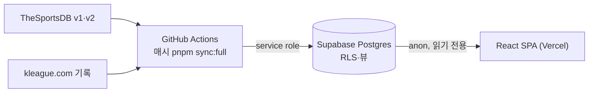

# AllLeaguesFans PRD (현행 코드 반영 수정판)

2026-11-18 · 원본: `docs/FM 스타일 실축 데이터 탐색 서비스 통합 PRD.md` (2026-11-16, 통합 v1.0)

## 0. 이 문서에 대해

원본 통합 PRD를 현재 저장소(`main`, 커밋 `7ad9894`)와 대조해, 바로 적용할 수 있는 요구사항은 살리고 현재 구조와 부딪치는 결정은 고쳐 쓴 문서다. 원본의 비전·UI 방향·데이터 신뢰성 규칙은 그대로 따른다. 바뀐 것은 주로 **데이터 공급자, 아키텍처, MVP 범위, 데이터 모델, 개발 환경, 일정**이다.

| 항목 | 내용 |
| --- | --- |
| 제품명 | AllLeaguesFans |
| 버전 | 수정판 v1.1 (원본 통합 v1.0 기반) |
| 기준 코드 | React 19 + Vite + TanStack Query v5 + Supabase + Vercel, 데이터는 TheSportsDB 프리미엄(v1·v2) + kleague.com 기록 |
| 기본 환경 | 한국어, 데스크톱 중심 반응형 웹(iPhone·iPad Safari 포함), 시간대 Asia/Seoul |
| 문서 성격 | 범위·설계 기준. 수치는 목표이며 측정값이 아님 |

### 0.1 원본 대비 핵심 변경

| 주제 | 원본 결정 | 수정 결정 | 이유 |
| --- | --- | --- | --- |
| 데이터 공급자 | Sportmonks 또는 TheStatsAPI로 교체 + K리그 공식 Open API | **TheSportsDB 유지**. 공급자 교체는 0단계 검증 결과가 나쁠 때만 검토(D-02) | 수집·매퍼·테스트·DB가 모두 TheSportsDB 기준으로 이미 돌아감. 교체는 사실상 재작성 |
| 수집 실행 | Supabase Edge Functions + pg_cron | **GitHub Actions 매시 정각 `pnpm sync:full` 유지** | 이미 운영 중, 실패 시 워크플로 실패로 드러남 |
| 읽기 경로 | Vercel Functions `/api/*` + CDN 캐시 | **브라우저 → Supabase(anon, RLS 읽기 전용, 뷰) 직접 조회 유지**. `/api`는 필요가 생긴 경로만 P1 | 현재 비밀키 노출 없이 동작. 별도 API 계층은 아직 필요 없음 |
| 진행 경기 갱신 | 5분 | **MVP는 매시 갱신**, 5분 갱신은 P1 별도 작업 | 현재 파이프라인은 1시간 주기 |
| MVP 대회 | K리그1·2 + 유럽 5대 + UCL | **K리그1·2 + 유럽 5대(현재 7개)**. UCL은 P1 | UCL 리그 페이즈·녹아웃을 담을 단계·그룹 컬럼이 `standings_v2`에 없음 |
| URL | `/leagues/:leagueId` | **`/leagues/:slug` 유지** (`k-league-1`, `premier-league` …) | 이미 공유되는 주소. 슬러그 ↔ TheSportsDB ID 매핑 존재 |
| 데이터 모델 | 신규 정규화 스키마(fixtures, league_seasons …) | **기존 `*_v2` 테이블을 유지·확장** (마이그레이션 20번부터) | 스키마 교체 대신 필요한 컬럼·테이블만 추가 |
| 개발 환경 | Docker + Supabase CLI 로컬 스택, CI에서 마이그레이션 자동 적용 | **Docker 없음, 마이그레이션은 Supabase SQL Editor에서 수동 적용 유지** | 1인 운영, 원격 DB 하나. 도입 비용 대비 이득 작음 |
| React 버전 | 18+ | **19** | 현재 버전 |

## 1. 현재 상태 대조

### 1.1 이미 있는 것 (원본 요구를 일부 또는 전부 충족)

| 원본 요구 | 현재 구현 | 상태 |
| --- | --- | --- |
| 리그 → 팀 → 선수/경기 이동 | `/leagues/:slug`, `/teams/:id`, `/players/:id`, `/matches/:id` | ✅ 동작 |
| 경로형 URL + 깊은 링크 | React Router v7, `vercel.json` 리라이트 | ✅ 동작 |
| 순위표(순위·경기·승무패·득실·승점·폼) | `standings_v2`, `FMStandings` | ✅ 동작 (구간 색은 규칙 미설정) |
| 라운드 이동 일정·결과 | `FMFixtures`, `getAllRounds` 등 | ✅ 동작 |
| 득점·도움 순위 | `top_scorers`/`top_assisters` 뷰, `FMPlayerStats` | 🟡 상위 10명, 원본은 20명 |
| 지난 우승팀 | `FMHistory`, `fetchHistoricalChampions` | ✅ 동작 (원본에 없던 기능, 유지) |
| 팀 개요·선수단·일정·통계 탭 | `TeamPageDB` `?tab=overview|squad|fixtures|stats` | ✅ 동작 |
| 한국어 팀명 | `teams_v2.nameKorean` 전 팀 채움(마이그레이션 19), `useTeamName` | ✅ 동작 |
| 통합 검색 | `GlobalSearch` + `searchByName`: 리그·팀·선수, 한글 띄어쓰기 무시, 줄임말 별칭(`team-aliases.ts`), ↑↓/Enter/Esc | 🟡 디바운스 200ms, `/`·`Ctrl+K` 없음, IME 조합 처리 없음, 선수 한글명 없음 |
| 경기 상세 | 점수판·상태·일시·경기장·대회, 주변 순위 | 🟡 라인업·이벤트·팀 통계 없음 (화면에 “아직 제공되지 않습니다” 안내) |
| 선수 상세 | `players_v2` 프로필 + `player_statistics` 시즌 기록 | 🟡 누락 기록이 `0`으로 표시됨 (`fetchPlayerDetail`) |
| 보안 | anon 읽기 전용 RLS(16), 뷰 `security_invoker`(17), `event_timelines` service-role 전용 | ✅ 동작 |
| 모바일 | 사이드바 서랍(`lg` 미만), 메인 `overflow-x-hidden` | 🟡 하단 탭바·표 첫 열 고정 없음 |
| CI | `ci-cd.yml`: typecheck·test·build, Vercel 프리뷰/프로덕션 | ✅ 동작 (린트·커버리지·E2E 없음) |

### 1.2 원본과 충돌하는 현재 사실

| 충돌 | 원본 | 현재 | 처리 |
| --- | --- | --- | --- |
| 공급자 | Sportmonks/TheStatsAPI | TheSportsDB 프리미엄 | 0.1 참조. TheSportsDB 유지 |
| K리그 선수 기록 출처 | K리그 공식 Open API(키·약관 확보 시) | kleague.com `/record/rankSort.do` (비공개 내부 엔드포인트, 리그·기록별 상위 30명, 득점·도움만) | 🔴 원본 9.5의 “공식 웹페이지는 자동 수집 허용을 가정하지 않는다”와 정면 충돌. 위험 R-01로 등록, 공식 Open API 문의를 오픈 이슈로 |
| 유럽 선수 기록 범위 | 출전·분·슈팅·패스·태클·평점 | `event_timeline` 집계: 득점·도움·카드·PK만 | 원본 PLAYER-02의 상세 열은 “미제공”으로 표시. 출전·분은 수집 경로 확인 전까지 제외 |
| 누락값 0 채우기 | 누락은 “—”, 0은 확인된 0만 | `player_statistics` 컬럼 `DEFAULT 0`, `fetchPlayerDetail`이 누락을 0으로, 마이그레이션 10이 과거 순위 지표를 0으로 저장 | P0 정리 작업(DATA-01~03)으로 편입 |
| 순위 갱신 시각 | 원천 갱신 시각이 없으면 수집 시각으로 꾸미지 않음 | `mapTheSportsDBStandingToDomain`이 `dateUpdated` 없으면 `new Date()`로 채움 | 수집 시각과 원천 시각을 분리(DATA-04) |
| 선수단 이력 | 현재 명단과 시즌별 소속 구분 | `players_v2`는 현재 명단 스냅샷(`idTeam` 하나), 수동 백필(`import-team-players.ts`) | 과거 시즌 명단은 MVP에서 “제공 안 함”으로 표시. 이력 모델은 P2 |
| 경기 부가 정보 | 라인업·이벤트·팀 통계 조건부 P0 | DB에 없음. 득점·카드 타임라인은 유럽 리그만 `event_timelines`에 있음(교체·VAR 제외, anon 접근 불가) | 유럽 리그 득점·카드 타임라인만 P0(공개 뷰 추가). 라인업·팀 통계는 TheSportsDB v2 제공 여부 확인 후 P1 |
| 연장·승부차기 점수 | 정규·연장·승부차기 별도 필드 | `events_v2`는 `homeScore`/`awayScore`만, 상태 `AET`·`PEN`은 있음 | 리그 경기만 다루는 MVP에서는 상태 표시로 충분. 컵·UCL(P1) 도입 시 컬럼 추가 |
| 상태 코드 | football-data.org 코드 기준 | TheSportsDB 코드(`NS`, `1H`, `HT`, `2H`, `ET`, `P`, `FT`, `AET`, `PEN`, `SUSP`, `INT` …), 체크 제약 제거(14) | 8.2를 TheSportsDB 기준으로 다시 씀 |
| 팀 ID 타입 | 내부 안정 ID | 문자열(`hist_*` 포함). 일부 옛 타입은 `number`(`fetchLeagues`가 K리그를 `249276`/`250127`로 바꿈) | 새 코드는 문자열. 숫자 ID 잔재 정리는 리그 페이지 작업 때 같이 |
| 엠블럼·사진 권리 | 권한 확인 전 이니셜 배지 | TheSportsDB 이미지 URL을 그대로 표시 | 즉시 제거하지 않음. TheSportsDB 이용 조건 확인을 오픈 이슈로(OI-03) |
| 개발 환경 | Docker, WSL 2, `.gitattributes` | 없음 | Docker 제외. `.gitattributes`는 Windows 기여자가 생기면 추가 |
| 테스트 도구 | Playwright(WebKit), 커버리지 80/90% | Vitest + Testing Library, 커버리지 측정 없음 | 커버리지는 측정부터(목표는 유지), Playwright는 P1 |
| 개발 절차 | 단일 개발자 TDD | `CLAUDE.md`의 3역할 흐름(Claude Code 구현 → Codex 테스트 → Codex 2차·`agy` 검증) | 현행 절차 유지, 13.3 참조 |

## 2. 제품 비전·목표

**비전:** “실제 축구를, FM처럼 깊게 본다.” 리그 순위에서 팀 스쿼드, 선수 기록, 경기 상세로 자연스럽게 이동하는 분석실 같은 경험.

**목표**

1. 리그 → 팀 → 선수 또는 경기를 3번 이내의 화면 이동으로 연결한다.
2. 리그·시즌·기록 범위와 데이터 기준 시각을 모든 화면에 명시한다.
3. 촘촘한 표, 정렬·필터, 빠른 통합 검색으로 탐색 자체를 즐겁게 만든다.
4. 누락·지연·정정 상태를 드러내고 확인된 실제 데이터만 보여준다.
5. PC, iPhone, iPad Safari에서 같은 핵심 흐름을 완료할 수 있게 한다.

**비목표**

- 경기 시뮬레이션, 구단 경영, 이적 협상, 세이브 파일, 3D 경기 재현
- 베팅·배당·승부 예측, 판타지 게임
- 회원가입·커뮤니티·소셜 기능 (즐겨찾기는 브라우저 저장)
- 뉴스 자동 수집, 유료 결제
- FM의 명칭·로고·스킨·스크린샷·독점 능력치(CA·PA) 사용

## 3. 대상 사용자와 핵심 이용 흐름

원본 3장을 그대로 따른다. 핵심 타깃은 숫자와 표에 익숙한 20~40대 축구 팬, 특히 FM 사용자다.

1. **응원팀 탐색:** 홈 → K리그1 → 순위표의 팀 → 선수단 → 특정 선수.
2. **경기 확인:** 오늘 경기 → 경기 상세 → 득점·카드(제공 시)·상대 전적 → 선수 → 시즌 기록.
3. **검색:** `/` 또는 `Ctrl+K` → 팀·선수 입력 → 유형별 결과 → 상세 → 뒤로 가기로 상태 복원.
4. **분석:** 리그 순위표 → 팀 → 선수단과 리그 득점·도움 상위 비교. (홈/원정 분리 순위는 P1)
5. **재방문:** 사이드바 즐겨찾기 팀 → 최근 결과와 다음 경기.

## 4. 출시 범위와 우선순위

MVP(P0)는 **현재 수집 중인 7개 리그**(K리그1 4689, K리그2 4822, EPL 4328, 라리가 4335, 세리에 A 4332, 분데스리가 4331, 리그 1 4334)의 현재 시즌을 대상으로 한다. 직전 시즌은 이미 적재된 순위·우승 기록만 노출한다. 대회 형식(리그·컵·UEFA)은 처음부터 데이터 모델에 자리를 두되, 화면은 리그 형식부터 만든다.

| 영역 | P0 · MVP | P1 · v1.5 | P2 · v2.0 |
| --- | --- | --- | --- |
| 대회 | 현재 7개 리그 | UCL(리그 페이즈·녹아웃), UEL·UECL, 국내 컵·슈퍼컵 (TheSportsDB 수록 확인 후) | 하부 리그, 타 대륙, 국가대항전 |
| 홈 | 오늘·이번 주 경기, 최근 결과, 리그별 1~4위, 즐겨찾기 팀 | 개인화 대시보드 | 위젯 편집 |
| 리그 | 순위(구간 색), 일정·결과, 득점·도움 Top 20, 팀 목록, 지난 우승팀 | 홈/원정 분리 순위, K리그 파이널 라운드(A/B) 분리 표시, 라운드별 순위 변동 | 시즌 아카이브 |
| 팀 | 개요, 선수단, 일정·결과, 시즌 기록·승률 도넛 | 전술판(사용자 편집), 이적·부상 | 구단 역사 |
| 선수 | 프로필, 시즌 기록(제공 항목만) | 최근 5경기 폼, 3명 비교, 실측 백분위 지표(실험) | 커리어 히스토리 |
| 경기 | 목록 페이지, 상태·점수, 상대 전적, 유럽 리그 득점·카드 타임라인 | 라인업·팀 통계(공급 확인 시), 5분 갱신 | 알림, xG·슈팅맵 |
| 탐색 | 통합 검색(한·영, 키보드), 정렬, 필터, 주소 공유 | 선수 한글명, 초성 검색, 필터 프리셋 | 추천 탐색 |
| 개인화 | 브라우저 즐겨찾기 | 열 표시 설정 | 로그인·동기화, PWA 알림 |
| 운영 | 수집 실행 기록(`sync_runs`), 실패 시 워크플로 실패 | 갱신 지연 경고, 관리 화면 | 복수 공급자 전환 |

**MVP 축소 순서:** 일정이 부족하면 유럽 득점·카드 타임라인 → 홈 즐겨찾기 요약 → 선수 목록 페이지 → 보조 통계 위젯 순으로 줄인다. 리그·팀·선수·경기 이동, 정확한 시즌 표시, 누락 구분은 유지한다.

## 5. 정보 구조와 URL

왼쪽 메뉴는 홈·리그·팀·선수·경기·즐겨찾기. 현재 사이드바는 홈 + 리그 목록 + (팀 페이지에서) 팀 탭이므로, 리그 목록은 “리그” 하위로 접고 나머지 항목을 추가한다.

| 화면 | 경로 | 현재 | 탭 | 주소에 유지할 상태 |
| --- | --- | --- | --- | --- |
| 홈 | `/` | 🟡 `LeagueListPage` 재사용 | — | 관심 리그는 로컬 설정 |
| 리그 목록 | `/leagues` | ✅ | — | country, q |
| 리그 상세 | `/leagues/:slug` | ✅ (탭 없음, 패널 배치) | 개요 · 순위 · 일정·결과 · 기록 · 팀 | season, tab, round |
| 팀 목록 | `/teams` | ⬜ | — | league, season, q, page |
| 팀 상세 | `/teams/:id` | ✅ | overview · squad · fixtures · stats (기존 값 유지) | tab, season |
| 선수 목록 | `/players` | ⬜ | — | league, season, team, position, q, sort, page |
| 선수 상세 | `/players/:id` | ✅ | 개요 · 시즌 기록 | tab, season |
| 경기 목록 | `/matches` | ⬜ | — | date, league, status |
| 경기 상세 | `/matches/:id` | ✅ | 개요 · 타임라인 · 상대 전적 | tab |
| 통합 검색 | `/search` | ✅ | 리그 · 팀 · 선수 | q, type |
| 즐겨찾기 | `/favorites` | ⬜ | — | type |
| 선수 비교 | `/compare` | P1 | — | p=a,b,c |

- 슬러그 매핑은 `src/lib/api.ts`의 `LEAGUE_SLUGS`가 기준이다. 새 대회를 추가할 때 여기와 `leagues` 테이블을 같이 갱신하고, 장기적으로는 `leagues.slug` 컬럼으로 옮긴다(P1).
- 팀·선수·경기 ID는 TheSportsDB ID 문자열을 그대로 쓴다. 공급자를 바꾸게 되면 그때 `external_ids` 매핑을 도입한다(원본 10장 항목, P2로 이동).
- 없는 경로·ID는 현재 텍스트 한 줄이다. 관련 목록 링크가 있는 404 화면으로 바꾼다(P0).

**상태 유지 규칙** (원본 그대로)

- 상세에서 팀·선수 링크를 누르면 리그·시즌 맥락을 유지한다.
- 직접 요청한 과거 시즌이 없으면 “해당 시즌 데이터 없음”을 표시하고 최신 시즌으로 몰래 바꾸지 않는다.
- 필터를 바꾸면 페이지를 1로 초기화하고, 뒤로 가기는 필터·정렬·스크롤 위치를 복원한다.
- 경기 상세는 경기 자체의 대회·시즌을 따른다.

## 6. UI/UX 디자인 시스템

원본 6장의 4영역 구조(상단 액션 바 + 좌측 사이드바 + 서브 탭 + 멀티 패널)를 목표로 하되, 현재 레이아웃(`RootLayout`: 320px 사이드바 + 상단 검색 바 + 본문 카드)에서 단계적으로 옮긴다.

### 6.1 레이아웃 전환

| 영역 | 현재 | 목표 |
| --- | --- | --- |
| 상단 바 | 검색 바만 (모바일은 메뉴 버튼 포함) | 좌: 뒤로·브레드크럼, 중앙: 검색(`/`, `Ctrl+K`), 우: 시즌 선택·동기화 배지 |
| 사이드바 | `lg:grid-cols-[20rem_1fr]` (320px), 리그 목록 나열 | 약 220px, 홈·리그·팀·선수·경기·즐겨찾기 + 즐겨찾기 바로가기 |
| 서브 탭 | 팀 페이지만(사이드바·`FMSubNav`) | 모든 상세 화면 상단에 탭 바 |
| 본문 | `FMBox` 패널 | 12컬럼 그리드 패널, `FMBox` 재사용 |

### 6.2 컬러·타이포그래피 토큰

현재 색은 Tailwind 유틸리티와 하드코딩 값(`#0b0d12` 배경, 보라·파랑 그라데이션 로고, `#3b82f6` 스크롤바)이 섞여 있다. 원본 후보값을 CSS 변수로 정의하고 Tailwind v4 `@theme`에 연결한 뒤 화면 단위로 바꾼다.

| 토큰 | 값 (초기 후보) |
| --- | --- |
| 배경 | `#10151F` |
| 패널 | `#192231` |
| 보더 | `#2A3447` |
| 본문 텍스트 | `#E7EDF5` |
| 강조 | `#5CD6B3` |
| 대륙대회권·승리(W) | `#10B981` |
| 무승부(D)·주의 | `#F59E0B` |
| 강등권·패배(L) | `#EF4444` |

- 숫자는 `tabular-nums`, 오른쪽 정렬. 표 최소 13px, 행 높이 28~32px.
- 상태(승·무·패, 진행·종료·연기)는 색과 문자를 함께 표시한다.
- 색값은 대비 검증 후 조정한다. FM 로고·스킨·전용 그래픽은 쓰지 않는다.

### 6.3 반응형·접근성

원본 6.3·6.4를 그대로 따른다. 현재 빠진 것만 적는다.

- 767px 이하 하단 탭바, 표 첫 열 고정, “상세 열 보기”. (현재는 서랍 메뉴만)
- 최소 360px 폭에서 페이지 전체가 좌우로 밀리지 않을 것. (현재 본문은 `overflow-x-hidden`으로 숨김 처리 — 표 자체 가로 스크롤로 바꿔야 잘린 열을 볼 수 있음)
- 키보드로 메뉴·탭·표 정렬·검색·즐겨찾기 조작, 포커스 표시, 터치 영역 44px, WCAG 2.1 AA 대비.
- 사이드바 영문 라벨(“Main”, “Competitions”, “Team Menu”, “Loading leagues...”)과 홈의 “Upcoming Matches”를 한국어로 바꾼다. 로딩 문구는 “로딩중…”.

## 7. 화면별 기능 요구사항

`현재` 열: ✅ 충족 · 🟡 일부 · ⬜ 없음.

### 7.1 통합 검색

| ID | 요구사항 | 완료 기준 | 현재 | 우선 |
| --- | --- | --- | --- | --- |
| SEARCH-01 | 리그·팀·선수 통합 검색 | 유형별 최대 10건, 국가·소속 표시 | 🟡 1글자부터 자동 검색 | P0 |
| SEARCH-02 | 한국어·영문 별칭 | 팀: 한글명·띄어쓰기 무시·줄임말 별칭. 선수: 영문명 | ✅ 팀 / ⬜ 선수 한글명 | P0 (선수 한글명은 P1) |
| SEARCH-03 | 입력 처리 | 300ms 디바운스, 2글자부터 자동 검색, 정확 일치 우선. 한글 2벌식은 마지막 글자를 다음 키까지 '조합 중'으로 두므로 조합 중인 글자까지 포함해 검색하고, 조합을 확정하는 Enter 한 번으로 검색(브라우저별 이벤트 순서 차이 흡수) | ✅ | P0 |
| SEARCH-04 | 키보드 | `/`·`Ctrl+K` 포커스, ↑↓ Enter Esc | 🟡 ↑↓ Enter Esc만 | P0 |
| SEARCH-05 | 동명이인 | 소속·국적·생년으로 구분 표시 | 🟡 소속만 | P0 |
| SEARCH-06 | 빈 결과 | “검색 결과 없음” + 검색 범위 안내 | ❔ 확인 필요 | P0 |
| SEARCH-07 | 초성 검색·오타 교정 | “ㅍㅎ” 등 | ⬜ | P1 |

검색은 Supabase에 수집된 데이터에서만 수행하고 외부 API를 부르지 않는다(현재와 같음).

### 7.2 홈

| ID | 요구사항 | 완료 기준 | 현재 | 우선 |
| --- | --- | --- | --- | --- |
| HOME-01 | 즐겨찾기 팀 우선 배치 | 즐겨찾기가 없어도 기본 화면 이용 | ⬜ | P0 |
| HOME-02 | 오늘·이번 주 경기, 최근 결과 | 날짜·KST 시각·상태, 경기 상세 연결 | 🟡 리그 카드 + 예정 경기 | P0 |
| HOME-03 | 리그별 1~4위 요약 | 순위표·팀 상세로 이동 | ⬜ | P0 |
| HOME-04 | 섹션별 기준 시각·상태 | 한 섹션 실패가 다른 섹션을 막지 않음 | ⬜ | P0 |

오늘 경기가 없으면 그 사실과 가장 가까운 예정 경기를 보여준다. 확인하지 않은 “인기 선수”나 뉴스로 빈칸을 채우지 않는다.

### 7.3 리그 상세

| ID | 요구사항 | 완료 기준 | 현재 | 우선 |
| --- | --- | --- | --- | --- |
| LEAGUE-01 | 시즌별 참가 팀 | 다른 시즌 팀이 섞이지 않음 | ✅ `standings_v2.season` | P0 |
| LEAGUE-02 | 순위표 | 순위·엠블럼·경기·승·무·패·득·실·득실·승점·최근 5경기 배지 | ✅ | P0 |
| LEAGUE-03 | 구간 색 | 리그·시즌별 설정값으로 관리, 확인된 규칙만 적용. 색 + 범례 문자 | ⬜ (TheSportsDB `description` 필드 활용 여부 확인) | P0 |
| LEAGUE-04 | K리그 파이널 라운드(A/B) | 스플릿 이후 A/B 그룹 구분 표시 | ❔ TheSportsDB 순위가 스플릿을 반영하는지 확인 필요 | P1 |
| LEAGUE-05 | 일정·결과 | 라운드 이동, 팀·상태 필터 | 🟡 라운드 이동만 | P0 |
| LEAGUE-06 | 득점·도움 Top 20 | 기록 범위·출처 표시, 미지원이면 안내 | 🟡 Top 10, 범위 표시 없음. K리그는 원천이 상위 30명뿐 | P0 |
| LEAGUE-07 | 홈/원정 분리 순위 | TOTAL·HOME·AWAY 전환 (`events_v2`로 계산 시 계산값임을 표시) | ⬜ | P1 |
| LEAGUE-08 | 라운드별 순위 변동 | 시점 순위 재구성 | ⬜ | P1 |
| LEAGUE-09 | 지난 우승팀 | 시즌별 우승팀 | ✅ (현재 기능 유지) | P0 |

순위는 공급자 순서를 따르고 “승점 → 득실차”를 자체 적용하지 않는다(현재 `rank` 그대로 사용).

### 7.4 팀 상세

| ID | 요구사항 | 완료 기준 | 현재 | 우선 |
| --- | --- | --- | --- | --- |
| TEAM-01 | 개요 | 구단명(한글)·엠블럼·창단·홈구장·현재 순위·최근 5경기·다음 경기 | ✅ 대부분 (마이그레이션 11·15) | P0 |
| TEAM-02 | 선수단 표 | 등번호·이름·포지션·만 나이·국적·득점·도움·카드. 열 정렬, GK·DF·MF·FW 필터. 출전·분·평점은 제공 시만 | 🟡 정렬·필터 확인 필요 | P0 |
| TEAM-03 | 선수단 기준 표시 | “현재 선수단 (기준일 YYYY-MM-DD)” 라벨. 과거 시즌 선택 시 “과거 명단 미제공” | ✅ 기준일 = 팀 명단의 최신 `players_v2.updated_at`(`import-team-players.ts`가 실행마다 기록). 과거 시즌 선택 UI는 없음 | P0 |
| TEAM-04 | 일정·결과·시즌 기록 | 홈/원정·상태 필터, 승무패 집계, 승률 도넛 | 🟡 | P0 |
| TEAM-05 | 링크 | 선수·상대팀·경기 링크 | ✅ | P0 |
| TEAM-06 | 전술판 | 사용자 배치 보드, “사용자 배치” 라벨 | ⬜ | P1 |

### 7.5 선수 목록·상세

선수 목록(`/players`)은 신규. 리그·팀·포지션·이름 필터, 기본 25명, 서버 측(PostgREST) 정렬·페이지네이션.

| ID | 요구사항 | 완료 기준 | 현재 | 우선 |
| --- | --- | --- | --- | --- |
| PLAYER-01 | 프로필 | 이름, 사진 또는 이니셜, 생년월일·만 나이, 국적, 키·체중, 포지션, 등번호, 현재 소속. 누락은 “미제공” | 🟡 `players_v2` 필드 있음, 누락 처리 확인 필요 | P0 |
| PLAYER-02 | 시즌 기록 | 리그·시즌·팀별로 **수집되는 항목만**: 득점·도움(전 리그), 카드·PK(유럽). 수집 안 되는 열은 표시하지 않거나 “미제공” | 🟡 누락이 0으로 표시됨 | P0 |
| PLAYER-03 | 동일 시즌 복수 팀 | 팀별 행 분리 | 🟡 고유키가 `idPlayer·idLeague·strSeason`이라 다른 리그로의 이적만 행이 나뉨. 같은 리그 안 이적은 한 행으로 합쳐지고 팀은 마지막으로 기록이 잡힌 소속이라 실제 소속과 다를 수 있음 (화면에 안내). 팀별 분리는 고유키에 `idTeam` 추가 + 수집 집계 변경 필요 | P0 |
| PLAYER-04 | 경기별 기록 | 실제 기록 있는 경기만 | ⬜ 원천 없음 | P1 (원천 확보 시) |
| PLAYER-05 | 기록 범위 안내 | K리그 득점·도움은 “리그 상위 30위 안 선수만 수집” 등 범위 명시 | ⬜ | P0 |
| PLAYER-07 | 최근 5경기 폼 | — | ⬜ | P1 |
| PLAYER-08 | 선수 비교 | 최대 3명 | ⬜ | P1 |
| PLAYER-09 | 실측 백분위 지표(실험) | 원본 D-05 조건 유지 | ⬜ | P1, 단 **현재 원천으로는 9개 중 결정력 일부·규율만 산정 가능**. 출전 시간 원천 없이는 90분당 계산 불가 → 원천 확보 전까지 보류 |

FM의 CA·PA, 별점 잠재력, 임의 평점은 제공하지 않는다.

### 7.6 경기 목록·상세

| ID | 요구사항 | 완료 기준 | 현재 | 우선 |
| --- | --- | --- | --- | --- |
| MATCH-01 | 경기 목록 페이지 | 날짜(어제·오늘·내일·기간)·리그·상태 필터, LIVE 필터, KST 날짜 경계 | ⬜ | P0 |
| MATCH-02 | 상태·점수 | 예정은 시각, 진행·종료는 확인된 점수, 연기·취소·중단 문구 | ✅ | P0 |
| MATCH-03 | 경기 정보 | 일시·경기장·대회·시즌·라운드 | ✅ (주심 없음) | P0 |
| MATCH-04 | 연장·승부차기 | `AET`·`PEN` 상태 문구 표시. 별도 점수 필드는 컵 도입 시 | 🟡 | P0 (표시) / P1 (필드) |
| MATCH-05 | 라인업 | 선발·후보·포메이션. 좌표 없으면 명단만 | ⬜ | P1 (TheSportsDB v2 라인업 제공 확인 후) |
| MATCH-06 | 타임라인 | 득점·도움·카드를 원본 순서·시간으로. 유럽 리그는 `event_timelines` 공개 뷰로 노출. K리그·교체·VAR는 “미제공” | ⬜ | P0 (유럽) |
| MATCH-07 | 팀 통계 | 점유율·슈팅·코너 비교 바 | ⬜ | P1 (원천 확인 후) |
| MATCH-08 | 상대 전적 | `events_v2`의 양 팀 완료 경기로 승무패·득점 비교. 수집 범위(적재된 시즌) 명시 | ⬜ | P0 |
| MATCH-09 | 기준 시각 | 마지막 수집 시각 표시 | ⬜ | P0 |

부가 정보가 없는 경기는 점수판·상대 전적·주변 순위를 기본 뷰로 두고 누락을 안내한다(현재 안내 문구를 유지·세분화). 포메이션 문자열만으로 위치를 추정하지 않는다.

### 7.7 즐겨찾기·공통

| ID | 요구사항 | 완료 기준 | 현재 | 우선 |
| --- | --- | --- | --- | --- |
| COMMON-01 | 즐겨찾기 | 리그·팀·선수 최대 100개 localStorage, 사이드바 노출, 저장 불가 시 안내 | ⬜ | P0 |
| COMMON-02 | 데이터 기준 시각 | 패널마다 마지막 수집 시각 | ⬜ | P0 |
| COMMON-03 | 한국어 표기 | 팀은 한글명 + 원문, 선수는 원문(한글명은 P1) | 🟡 | P0 |
| COMMON-04 | 출처 표기 | 푸터에 TheSportsDB·K리그 출처, 오류 제보 링크 | ⬜ | P0 |
| COMMON-05 | 열 표시 설정 | 로컬 저장 | ⬜ | P1 |
| COMMON-06 | 404 화면 | 관련 목록으로 가는 링크 | ⬜ | P0 |

### 7.8 데이터 정리 (신규, 원본 규칙 위반 해소)

| ID | 작업 | 완료 기준 | 우선 |
| --- | --- | --- | --- |
| DATA-01 | `fetchPlayerDetail`의 누락 → 0 변환 제거 | 누락 기록이 “—”로 표시 | P0 |
| DATA-02 | `player_statistics` 가변 통계 컬럼 `DEFAULT 0` → NULL 허용, 수집 시 미수집 항목은 NULL | 새 마이그레이션, 재실행 안전 | P0 |
| DATA-03 | 마이그레이션 10이 0으로 저장한 과거 순위 지표를 NULL로 | 과거 시즌 순위 지표가 “—”로 표시 | P0 |
| DATA-04 | 순위 `lastUpdated`의 `new Date()` 대체값 제거, 수집 시각은 별도 컬럼 | 원천 시각과 수집 시각 구분 | P0 |
| DATA-05 | 숫자 리그 ID 잔재(`249276`/`250127`) 정리 | 리그 ID를 TheSportsDB 문자열로 통일 | P1 |

## 8. 데이터 표시·계산 규칙과 상태 처리

### 8.1 표시·계산 규칙

원본 8.1을 그대로 따른다. 프로젝트 고유 사항만 덧붙인다.

| 항목 | 규칙 |
| --- | --- |
| 실제 0 / 누락 | 원천에서 0이 확인된 경우만 0, 그 외 “—” + “미제공” |
| 시즌 | DB 키는 시작 연도(`'2026'`). 표시는 K리그 `2026`, 유럽 `2026/27`. 현재 시즌은 `getCurrentSeasonForFormat(format)` (유럽은 7월 시작) |
| 날짜·시간 | UTC 저장, Asia/Seoul 표시. TheSportsDB `dateEvent`+`strTime`은 UTC로 해석(현재 매퍼와 같음) |
| 기록 범위 | K리그 득점·도움은 리그별 상위 30명만 수집됨을 표시. 유럽 기록은 리그의 완료 경기 타임라인이 모두 캐시된 뒤에만 기록됨 |
| 비율·90분당 | 분자·분모가 모두 있을 때만. 출전 시간 원천이 없으므로 MVP에서는 90분당 지표 없음 |
| 표 정렬 | 누락값은 양방향 모두 마지막, 동률은 안정 보조 키 |
| 최근 5경기 | 확인된 완료 경기 최대 5개, 취소·연기 제외 |

### 8.2 경기 상태 (TheSportsDB 기준)

원천 코드를 `events_v2.status`에 그대로 두고 화면에서 서비스 상태로 묶는다. 매핑은 한 모듈(예: `src/lib/match-status.ts`)로 모으고 현재 페이지마다 흩어진 상태 배열(`FINISHED_STATUSES` 등)을 대체한다.

| 서비스 상태 | 원천 코드 (현재 코드에서 쓰는 값) | 표시 | 처리 |
| --- | --- | --- | --- |
| 예정 | `SCHEDULED`, `NS`, `UNKNOWN`(시간 미정 포함) | 시작 시각 또는 “일정 미정” | 0:0을 미리 표시하지 않음 |
| 진행 | `IN_PLAY`, `LIVE`, `1H`, `2H`, `ET`, `BT`, `P` | 진행 중 + 구간 | 확인된 점수 + 마지막 수집 시각 |
| 하프타임 | `HT` | 하프타임 | 경기 시간 자체 증가 안 함 |
| 종료 | `FINISHED`, `FT`, `AET`, `PEN` | 경기 종료 (연장·승부차기 표기) | — |
| 연기·취소 | `POSTPONED`, `CANCELED` | 연기·취소 | 승무패 집계 제외 |
| 중단 | `SUSP`, `INT` | 경기 중단 | 최종 결과로 보지 않음 |
| 알 수 없음 | 그 외 | 상태 확인 중 | 원천 코드 로그 |

❔ TheSportsDB가 실제로 내려주는 전체 코드 목록(`PST`, `CANC`, `ABD`, `AWD` 등 포함 여부)은 `events_v2.status` 고유값 조회로 확정한다.

### 8.3 화면 상태

원본 8.3을 그대로 따른다: 로딩(크기 유지 스켈레톤) · 결과 없음 · 미제공 · 수집 지연 · 요청 실패(마지막 데이터 유지 + 재시도) · 부분 실패 · 이미지 실패(이니셜 배지, `CrestImg` 확장) · 잘못된 ID(404).

## 9. 데이터 공급과 검증·라이선스

### 9.1 공급 구조 (현행)

| 역할 | 공급원 | 범위 | 비고 |
| --- | --- | --- | --- |
| 주 공급자 | TheSportsDB 프리미엄 v1 | 리그·팀·순위(`lookuptable`)·시즌 일정(`eventsseason`) | 7개 리그 |
| 경기 타임라인 | TheSportsDB v2 `event_timeline` | 유럽 5대 리그 득점·도움·카드 | 1회 실행당 600요청·12분 제한, `event_timelines` 캐시 |
| K리그 선수 기록 | kleague.com `/record/rankSort.do` | K리그1·2 득점·도움 상위 30명 | 🔴 비공개 내부 엔드포인트 (R-01) |
| 과거 우승·선수단 | 수동 스크립트 (`import-historical-champions-euro.ts`, `import-team-players.ts`) | 유럽 우승 이력, `players_v2` | 정기 실행 아님 |

원본의 통합 공급자 후보(Sportmonks, TheStatsAPI) 비교와 선정 절차는 **D-02의 대안**으로 보존한다. 아래 0단계 검사에서 TheSportsDB가 다음 중 하나를 못 채우면 그 절차를 다시 연다.

- K리그 경기 결과·일정의 정확도 (kleague.com 공식 기록 20경기 표본 대조)
- 라인업·팀 통계·진행 중 경기 일괄 조회(v2) 제공 여부
- UCL·컵 대회의 단계·라운드·합산 정보

### 9.2 리그·시즌 공개 검사 (게이트)

원본 9.5를 따른다. 현재 7개 리그는 이미 공개 중이므로, 0단계에서 표본 대조만 수행하고 문제가 있는 항목은 “미제공”으로 내린다. 새 대회(P1)는 검사 통과 후 공개한다.

### 9.3 라이선스·출처

- TheSportsDB와 kleague.com의 공개 웹 표시·상업 이용·캐시 조건을 확인한다(OI-02, OI-03).
- 엠블럼·사진은 현재 TheSportsDB URL을 쓴다. 조건 확인 결과 문제가 있으면 이니셜·대표색 배지로 바꾼다.
- “Football Manager” 명칭·로고·UI 에셋을 쓰지 않는다. 화면의 `FM*` 컴포넌트 이름은 내부 코드명이며 사용자에게 노출하지 않는다.

## 10. 데이터 모델

원본의 논리 모델을 현재 테이블에 대응시키고, 빠진 것만 새 마이그레이션(20번부터, 재실행 안전)으로 추가한다.

| 원본 엔터티 | 현재 테이블 | 차이 | 조치 |
| --- | --- | --- | --- |
| leagues | `leagues` (TheSportsDB 원형 컬럼 `idLeague`, `strLeague`, `strCurrentSeason` …) | 한글명·형식·구간 규칙 없음 | `nameKorean`, `slug`, `format`(league/cup/uefa), `seasonFormat` 추가 (P0~P1) |
| league_seasons | 없음 (`strCurrentSeason`만) | 시즌 메타·커버리지 없음 | P1 |
| zoneRules | 없음 | 구간 색 규칙 | `league_zone_rules(leagueId, season, fromRank, toRank, kind)` (P0) |
| teams | `teams_v2` (텍스트 ID, `nameKorean`) | 충족 | 유지 |
| players | `players_v2` | 한글명 없음 | `nameKorean` (P1) |
| squad_memberships | `players_v2.idTeam` (현재 소속만) | 이력 없음 | P2. MVP는 “현재 선수단 기준일” 표시만 |
| player_season_stats | `player_statistics` | 가변 통계 `DEFAULT 0` | DATA-02 |
| fixtures | `events_v2` | 연장·승부차기·합산·단계 컬럼 없음 | 컵·UCL(P1) 도입 시 추가 |
| standings | `standings_v2` (PK league+team+season) | 단계·그룹·TOTAL/HOME/AWAY 없음 | UCL·홈원정(P1) 때 PK 확장 마이그레이션 |
| match_events | `event_timelines` (JSONB, 득점·카드, service-role 전용) | 공개 경로 없음 | 허용 필드만 내보내는 `security_invoker` 공개 뷰 (P0) |
| match_lineups, match_team_stats | 없음 | — | P1 (원천 확인 후) |
| external_ids | 없음 (TheSportsDB ID가 곧 내부 ID) | — | 공급자 교체 시 (P2) |
| entity_aliases | `src/lib/team-aliases.ts` (코드 상수) | DB가 아님 | 유지. 선수 별칭이 필요해지면 테이블로 (P1) |
| sync_runs | 없음 (워크플로 로그만) | 기준 시각·지연 판단 불가 | `sync_runs(step, startedAt, finishedAt, ok, requests, error)` + anon 읽기용 최신 성공 시각 뷰 (P0) |
| player_metrics | 없음 | — | P1 실험, 원천 확보 후 |

## 11. 시스템 아키텍처와 수집

- 수집은 GitHub Actions에서만 돌고, 브라우저는 Supabase를 anon 키로 읽기만 한다. 외부 API 키와 service role 키는 Actions 시크릿에만 있다.
- 실행이 겹치지 않고, 단계 하나라도 실패하면 exit 1로 워크플로가 실패한다(현행). `keepalive.yml`이 스케줄 비활성화를 막는다.
- 원본 11.1의 Vercel Functions 읽기 API는 두지 않는다. 다음 중 하나가 생기면 해당 경로만 `/api`로 만든다(P1): 응답 캐시가 필요한 무거운 집계, 서버 전용 검색 인덱스, 외부 호출이 필요한 조회.

### 11.1 수집 주기

| 대상 | MVP (현행) | P1 목표 |
| --- | --- | --- |
| 순위·팀 | 매시 | 매시 |
| 시즌 일정·결과 | 매시 | 경기일 15분, 진행 경기 5분 (별도 경량 워크플로 또는 v2 라이브 엔드포인트) |
| 유럽 타임라인 | 매시, 실행당 600요청·12분 | 종료 직후 + 다음 날 보정 |
| K리그 득점·도움 | 매시 | 공식 경로 확보 후 재설계 |
| 선수단 | 수동 | 하루 1회 |

GitHub Actions 스케줄은 정시 실행이 보장되지 않으므로, 5분 갱신이 필요해지면 실행 간격·지연을 실측한 뒤 방식을 정한다(D-06).

### 11.2 최신성·호출 방어

- 모든 패널에 마지막 성공 수집 시각을 표시한다(`sync_runs` 기반). 예정 간격(현재 1시간)의 2배가 지나면 “갱신 지연”.
- 429·5xx는 2/4/8초 백오프로 최대 3회 재시도(현행 `fetchWithRetry`). 실패·빈 응답으로 정상 데이터를 지우지 않고, 재실행해도 행이 중복되지 않는다(upsert).
- 점수 갱신이 성공했다고 실패한 다른 단계의 기준 시각까지 새로 쓰지 않는다(단계별 기록).

## 12. 기술 스택

| 계층 | 현재 | 수정 결정 |
| --- | --- | --- |
| 프런트엔드 | React 19, TypeScript strict, Vite 7 | 유지 |
| 라우팅 | React Router v7 `createBrowserRouter`, 지연 로딩 | 유지 |
| 서버 상태 | TanStack Query v5 | 유지 |
| 표 | 직접 구현 | 정렬·필터·열 숨김이 3곳 이상 필요해지면 TanStack Table 도입 검토 |
| 스타일 | Tailwind CSS v4 (`@tailwindcss/postcss`) | 유지 + CSS 변수 토큰(6.2) |
| 아이콘 | lucide-react | 유지 |
| 차트·피치 | 없음 | 경량 SVG 자체 구현 |
| 읽기 | Supabase anon + RLS + `security_invoker` 뷰 | 유지 |
| 수집 | `tsx scripts/sync/orchestrator.ts` on GitHub Actions | 유지 |
| 테스트 | Vitest + Testing Library (jsdom), `src/tests/` | 유지 + 커버리지 측정 추가. Playwright는 P1 |
| CI/CD | `ci-cd.yml`(typecheck·test·build), Vercel 프리뷰/프로덕션 | 린트(`eslint .`, 수정 없이 검사) 단계 추가 |
| 분석 | 없음 | 쿠키 없는 도구 하나 (D-09) |

### 12.1 테스트 항목

원본 12.2의 목록을 현재 코드에 맞춰 적용한다.

1. **단위 (`src/lib`, `src/lib/mappers`):** 시즌 판정(`season.ts`), KST 날짜 경계, 만 나이, 상태 코드 매핑(8.2), null·0·분모 0 구분, 최근 5경기 선택, 상대 전적 집계, 구간 규칙 적용, 타임라인 매핑(기존 테스트 확장).
2. **컴포넌트:** 순위표 구간 색·범례, 검색(디바운스·IME 조합 중 미검색·`/`·`Ctrl+K`·키보드 이동), 선수단 필터·정렬·기준일 라벨, 패널 상태(로딩·미제공·지연·실패), 즐겨찾기 저장 실패 안내.
3. **수집:** 재실행 멱등성, 빈 응답 시 데이터 보존, `sync_runs` 기록.
4. **E2E (P1, Playwright WebKit 포함):** 리그→팀→선수→경기, 직접 URL, 360·390·768px.
5. **DB 무결성:** `pnpm test:integration` (현행).

커버리지 목표(전체 80%, 도메인 로직 90%)는 유지하되, 먼저 현재 수치를 측정해 기준선을 기록한다.

### 12.2 개발 절차

`CLAUDE.md`를 따른다.

1. 기능 브랜치 → PR → `main` (Vercel 프리뷰 확인).
2. 커밋 전 `pnpm typecheck`, `pnpm lint:unused`, `pnpm test`, `pnpm build`.
3. 비자명한 변경은 Claude Code 구현 → Codex CLI 테스트 작성 → Codex 2차 리뷰 + `agy` 교차 검증.
4. 스키마 변경은 `scripts/migrations/`에 다음 번호로, 재실행 안전하게 쓰고 SQL Editor에서 수동 적용.
5. 머지 후 프로덕션 사이트에서 확인.

## 13. 비기능 요구사항과 성과 지표

원본 13장의 목표를 유지한다. 현재 구조에 맞춰 바꾼 항목만 적는다.

| 영역 | 원본 | 수정 |
| --- | --- | --- |
| 내부 조회 API p95 500ms | Vercel 함수 기준 | Supabase PostgREST 조회 기준으로 측정 |
| 예정 수집 성공률 99% | 수집 함수 | GitHub Actions `data-sync` 실행 성공률 |
| 진행 경기 게시 지연 p95 30초 | 5분 수집 전제 | P1(5분 갱신 도입 후)로 이동 |
| 초기 JS 200KB(gzip) | — | `pnpm analyze:bundle`로 기준선 측정 후 판단 |

제품 지표(세션당 페이지뷰, 연결 탐색률, 검색 결과 선택률, 7일 재방문률 등)는 분석 도구(D-09) 도입 후 측정한다. 검색어 원문은 저장하지 않는다.

## 14. 출시 인수 기준

원본 16개 시나리오 중 현재 범위에 맞게 조정한다.

| ID | 시나리오 | 통과 기준 | 변경 |
| --- | --- | --- | --- |
| AC-01 | 리그→팀→선수→경기 이동 | 3클릭 이내, 시즌 맥락 유지 | — |
| AC-02 | 시즌 전환 후 새로고침 | 상태 유지, 시즌 혼입 없음 | — |
| AC-03 | 직접 URL·없는 ID | 정상 렌더링, 404 화면 | — |
| AC-04 | 한글·영문·줄임말 팀 검색, 키보드 | 같은 팀으로 연결, `/`·`Ctrl+K`·↑↓ 동작 | 선수 한글 검색 제외 |
| AC-05 | 선수의 시즌 중 이적 | 팀별 기록 분리 | PLAYER-03 확인 결과에 따름 |
| AC-06 | 과거 시즌 선수단 | 현재 명단을 과거 명단으로 표시하지 않음 | — |
| AC-07 | 예정·진행·종료·연기·취소·중단 | 상태별 표시, LIVE 필터 | — |
| AC-08 | 연장·승부차기 | `AET`·`PEN` 문구 표시 | 별도 점수·득점 정정은 P1 |
| AC-09 | null·0·사진 없음 | 서로 다르게 표시, 이니셜 대체 | DATA-01~03 완료 필요 |
| AC-10 | 경기 부가 데이터 없음 | 점수판·상대 전적 유지, 누락 안내 | — |
| AC-11 | 수집 실패 | 마지막 정상 데이터 유지, 지연 표시 | 429 재시도는 현행 |
| AC-12 | 수집 반복 | 중복 행 없음 | — |
| AC-13 | KST 자정 전후 경기 | 날짜 필터와 킥오프 날짜 일치 | — |
| AC-14 | 360·390·768px, iPhone·iPad Safari | 핵심 작업 완료, 가로 밀림 없음 | 실기기 수동 확인 (E2E는 P1) |
| AC-15 | 키보드 조작 | 포커스 이동·표시 | 자동 갱신 항목은 P1 |
| AC-16 | 운영 점검 | 비밀키 노출 없음, anon 쓰기 불가, 출처 표기 | — |

## 15. 마일스톤

이미 리그·팀·선수·경기 화면과 수집 파이프라인이 있으므로, 원본의 “6단계 약 11주”를 그대로 쓰지 않고 남은 작업만 단계로 나눈다. 기간은 0단계 후 다시 추정한다.

| 단계 | 내용 | 게이트 |
| --- | --- | --- |
| 0. 데이터 점검 | K리그 20경기 공식 기록 대조, `events_v2.status` 고유값 확인, TheSportsDB v2 라인업·통계·라이브 제공 확인, 이용 조건 확인(OI-02·03) | D-02 확정 (TheSportsDB 유지 또는 교체 절차 재개) |
| 1. 데이터 정리 | DATA-01~04, `sync_runs`, `event_timelines` 공개 뷰, 구간 규칙 테이블 | 마이그레이션 적용, 무결성 테스트 통과 |
| 2. 셸·디자인 토큰 | 6.1 레이아웃, 6.2 토큰, 사이드바 6개 메뉴, 404, 영문 라벨 한국어화, 푸터 출처 | 360px~1440px 수동 확인 |
| 3. 탐색 기능 | 검색 보강(SEARCH-01·03~06), 즐겨찾기, `/matches`·`/teams`·`/players` 목록 | AC-01~04 |
| 4. 상세 보강 | 홈(HOME-01~04), 리그 구간 색·Top 20·필터, 팀 기준일 라벨, 선수 기록 범위 안내, 경기 타임라인·상대 전적·기준 시각 | AC-05~13 |
| 5. 출시 점검 | 접근성·모바일 실기기·운영 점검 | AC-14~16 |

## 16. 위험, 결정 기록, 오픈 이슈

### 16.1 주요 위험

| ID | 위험 | 영향 | 대응 |
| --- | --- | --- | --- |
| R-01 | 🔴 K리그 선수 기록을 kleague.com 비공개 내부 엔드포인트에서 받음 | 차단·응답 형식 변경 시 K리그 득점·도움 중단, 이용 조건 위반 소지 | 연맹에 공식 Open API 키·이용 조건 문의(OI-01). 실패 시 표시를 “수집 중단”으로 내리고 기존 값 유지 |
| R-02 | 선수 상세 기록 원천 부족(출전·분·슈팅 등 없음) | 선수 화면이 얇음, 백분위 지표 불가 | 제공 항목만 표시, 범위 안내. 원천 확보는 D-02와 함께 판단 |
| R-03 | 매시 수집으로 진행 경기 점수가 최대 1시간 늦음 | 경기 중 사용자 신뢰 저하 | 진행 경기에 “마지막 갱신 HH:MM” 상시 표시. 5분 갱신은 P1 |
| R-04 | 누락값 0 표시 잔재 | 잘못된 기록으로 오해 | DATA-01~03을 P0 첫 작업으로 |
| R-05 | TheSportsDB 이미지·데이터 이용 조건 미확인 | 법적 문제 | OI-03 확인, 필요 시 이니셜 배지 |
| R-06 | UCL·컵 형식을 현재 스키마가 못 담음 | P1 확장 지연 | P1 착수 전 `standings_v2`·`events_v2` 확장 설계 |
| R-07 | FM 유사성 | 상표·트레이드 드레스 분쟁 | 명칭·로고·에셋 미사용, 자체 색·아이콘 |
| R-08 | FM형 표가 모바일에서 과밀 | 탐색 실패 | 핵심 열 우선, 첫 열 고정, 실기기 검증 |

### 16.2 결정 기록

| ID | 항목 | 원본 기본안 | 수정 기본안 | 확정 시점 |
| --- | --- | --- | --- | --- |
| D-01 | 서비스명 | AllLeaguesFans (가칭) | AllLeaguesFans (운영 중) | 확정 |
| D-02 | 데이터 공급자 | Sportmonks 또는 TheStatsAPI + K리그 Open API | TheSportsDB 유지. 0단계 결과가 나쁘면 원본 후보 비교 절차 재개 | 0단계 후 |
| D-03 | 배포·수집 구조 | Vercel 함수 + Supabase Edge Functions | Vercel 정적 SPA + Supabase 직접 조회 + GitHub Actions 수집 | 확정 |
| D-04 | MVP 대회 | K리그1·2 + 유럽 5대 + UCL | 현재 7개 리그. UCL은 P1 | 확정 |
| D-05 | 실측 백분위 지표 | P1 실험 | P1 실험, 단 출전 시간 원천 확보 전까지 보류 | 원천 확보 시 |
| D-06 | 진행 경기 갱신 | 목표 5분 | MVP 매시, P1에서 5분 | 실행 지연 실측 후 |
| D-07 | 로그인 | MVP 제외 | MVP 제외 | — |
| D-08 | 시즌 범위 | 최신 + 직전 시즌 | 현재 시즌 전체 + 적재된 과거 순위·우승 기록 | 확정 |
| D-09 | 분석 도구 | Cloudflare Web Analytics 예시 | 쿠키 없는 도구 하나 (Vercel Web Analytics 또는 Cloudflare) | 2단계 전 |
| D-10 | 개발 환경 | Docker + Supabase CLI | 도입 안 함 | 확정 |

### 16.3 오픈 이슈

- [ ] OI-01 K리그 공식 Open API 인증키 발급 조건과 공개 웹 표시·캐시 허용 범위 (연맹 문의)
- [ ] OI-02 kleague.com 기록 페이지 자동 수집이 허용되는지
- [ ] OI-03 TheSportsDB 프리미엄 데이터·이미지의 공개 웹 표시·상업 이용 조건
- [ ] OI-04 TheSportsDB v2가 라인업·팀 통계·진행 경기 일괄 조회를 7개 리그에 제공하는지
- [ ] OI-05 TheSportsDB K리그 순위가 파이널 라운드(A/B) 분리를 반영하는지
- [ ] OI-06 `player_statistics`가 같은 시즌 복수 팀을 별도 행으로 저장하는지
- [ ] OI-07 개인 프로젝트인지, 광고 등 수익화를 고려하는지 (공급자 플랜·이용 조건이 달라짐)

### 16.4 참고

- 원본 PRD: `docs/FM 스타일 실축 데이터 탐색 서비스 통합 PRD.md` (공급자 후보 비교·참고 링크 포함)
- 저장소 규칙: `CLAUDE.md`
